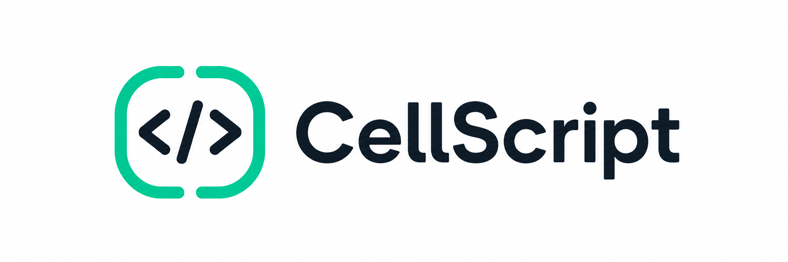

  

**Author typed Cell policies and build inspectable RISC-V artifacts for CKB.**

CellScript is a language and toolchain for CKB Cell contracts. It compiles
`.cell` packages into RISC-V assembly or ELF, with typed metadata, lowering
records and source maps. Its public builders and CKB adapter connect those
contracts to concrete transaction bytes, signing and execution evidence.

[Get started](#get-started) · [Language example](#language-example) ·
[Part 2: pools, orders and settlement](#part-2-basic-pools-orders-and-settlement) ·
[Builders and recovery](#builders-signatures-and-recovery) ·
[Evidence](#artifact-and-execution-evidence) ·
[Documentation](#documentation) · [Development](#development)

## Current status

This is the **`0.36` development branch**, based on `0.35`. It retains Part 2's
basic pools, orders and settlement as ordinary protocol packages and implements
[the layout and lowering contract](docs/CELLSCRIPT_LAYOUT_LOWERING_CONTRACT.md)
under [issue #104](https://github.com/CellScript-Labs/CellScript/issues/104).
Existing source syntax and public wire contracts remain separate from internal
call, frame and machine-layout decisions; the checker validates actual machine
behavior independently.

The [implementation and acceptance record](docs/reports/0.36/ISSUE_104_ACCEPTANCE.md)
separates source/byte compatibility, VM execution, checker mutations and browser
size evidence. It retains the observed failures and their corrections.

| Identity | Current value | Meaning |
| --- | --- | --- |
| Development branch | `0.36`, based on `0.35` | A source workstream, not a published release |
| Native workspace version | `0.33.0-alpha.2` | The version in the current Cargo manifests |
| Source edition | `2027` | The sole current source contract across native and browser analysis |
| Latest published prerelease | [`v0.33.0-alpha.2`](https://github.com/CellScript-Labs/CellScript/releases/tag/v0.33.0-alpha.2) | Published 2026-11-05, before this branch's Part 2 changes |
| Latest stable-tagged release | [`v0.31.0`](https://github.com/CellScript-Labs/CellScript/releases/tag/v0.31.0) | A separately versioned release with its own source and evidence |
| Rust toolchain | `1.97.1` | Pinned by [rust-toolchain.toml](rust-toolchain.toml) |

The language and public APIs remain evolving alpha contracts. The
[source contract](docs/CELLSCRIPT_SOURCE_CONTRACT.md),
[branch context](BRANCHES.md) and [changelog](CHANGELOG.md) distinguish current
development, published artifacts and historical evidence. Browser, editor and
service distributions retain their own build and publication identities.

Part 2 has focused implementation, model, VM replay and disposable-node
evidence. Gates and CI were not run for this work at the maintainer's
instruction. Historical gate results apply to their recorded snapshots;
they do not establish this branch's integration or release readiness.
Application security review and public deployment require their own evidence.

## What CellScript expresses

Programs validate proposed Cell transformations. A transaction supplies
existing inputs and proposed outputs; the compiled Scripts check their data,
identities, authorization and relationships.

- **Typed state and ownership.** Resources describe Cell-backed values;
  lifecycle rules account for their consumption, replacement and output roles.
- **Explicit successor policies.** Data, Lock, Type Script and capacity
  treatments are written in source. Business identity remains a separate
  obligation.
- **Bounded transaction access.** Typed views, nested fixed data, collections
  and selected input/output roles have explicit executable profiles and limits.
- **Inspectable artifacts.** An independent checker validates versioned
  contracts against the emitted ELF and its sidecars.
- **Public transaction interfaces.** Generated builders, parameter codecs and
  ProtocolBundle records expose obligations to client applications.

The [authoring grammar](docs/CELLSCRIPT_AUTHORING_GRAMMAR.md),
[collection matrix](docs/CELLSCRIPT_COLLECTIONS_SUPPORT_MATRIX.md) and
[CKB runtime-view matrix](docs/CELLSCRIPT_0_30_CKB_RUNTIME_VIEW_MATRIX.md) define
the supported boundaries. Reserved or unsupported runtime shapes fail closed;
a declaration in metadata alone does not establish executable support.

## Get started

### Build this source checkout

The commands below select this development line. Run the clone commands from a
parent directory where the two repositories can be siblings. An existing
`../ckb-sdk-rust` checkout must match the documented `v5.1.0` pin.

~~~bash
git clone --branch 0.36 --single-branch https://github.com/CellScript-Labs/CellScript.git
git clone --branch v5.1.0 --depth 1 https://github.com/nervosnetwork/ckb-sdk-rust.git
cd CellScript

cargo build --locked -p cellscript --bin cellc
export PATH="$PWD/target/debug:$PATH"
cellc --version
~~~

The repository selects Rust 1.97.1 through `rust-toolchain.toml`. Native build
inputs are locked in `Cargo.lock`. Submodules are needed for the corresponding
website, editor, proposal and integration workflows; see
[Development](#development) before running those.

### Check and build a bundled package

From the repository root, using the compiler just built:

~~~bash
cd examples/token

cellc check --target-profile ckb
cellc build --target riscv64-elf --target-profile ckb --entry-action transfer_token

cellc verify-artifact build/main.elf --verify-sources --json
cellc gen-builder \
  --metadata build/main.elf.meta.json \
  --target typescript \
  --output sdk
~~~

This selects one existing Token action and generates its TypeScript SDK from
the matching metadata. Artifact verification does not execute the transaction,
select live Cells, sign, submit or deploy it. The
[builder tutorial](docs/wiki/Tutorial-17-ProtocolBundle-End-to-End.md) covers
the subsequent transaction workflow.

### Start a new package

~~~bash
cellc new my_contract
cd my_contract
~~~

The scaffold is a package skeleton. Write the contract in `src/main.cell`,
then intentionally pin its source graph and build:

~~~bash
cellc lock
cellc check --target-profile ckb
cellc build --target riscv64-elf --target-profile ckb
~~~

Use `cellc --help` and `cellc <command> --help` for command-specific arguments.
`cellc build` operates on the current package; direct file compilation uses
`cellc path/to/source.cell`.

### Use a published binary

For the stable release, open the [v0.31.0 release](https://github.com/CellScript-Labs/CellScript/releases/tag/v0.31.0)
and use its matching source and documentation. From this checkout, the
[current installer](scripts/install.sh) can select it explicitly:

~~~bash
CELLSCRIPT_VERSION=0.31.0 sh scripts/install.sh
~~~

This checkout's installer requires a SHA-256 digest from github.com's
`SHA256SUMS` or an explicit `CELLSCRIPT_INSTALL_SHA256`. Archive mirrors do not
supply the trusted checksum. Older release-attached installers retain their
own behavior.

The [alpha.2 release page](https://github.com/CellScript-Labs/CellScript/releases/tag/v0.33.0-alpha.2)
lists its actual assets, checksums and publication receipt. Its current native
archive is Linux x86_64 GNU; it does not include an `install.sh`, browser WASM
or VSIX attachment. Use the release's instructions or build from matching
source. A published binary does not include the later `0.35` or `0.36` branch changes.

## Language example

The following source is the tracked
[explicit Type Script example](examples/semantic-foundation-2027/src/main.cell).
It binds an input, a witness parameter and an output to the running Type group.

~~~cellscript
module cellscript::examples::semantic_foundation_2027

resource Token has store, replace, relock {
    owner: Address,
    amount: u64,
}

type_script TokenTransfer on type_group<Token> {
    action transfer(
        input token: Token from group_input[0],
        witness recipient: Address from group_witness.input_type,
        output next: Token from group_output[0],
    ) {
        require token.amount > 0

        replace token -> next {
            data {
                owner = same
                amount = same
            }
            type_script = same
            lock = exact(recipient)
            capacity = same
        }
    }
}
~~~

The relation preserves both data fields, the complete Type Script identity and
capacity, while constraining the successor Lock. The `owner` data field stays
unchanged in this example; it is distinct from the Cell's spending Lock.
The input Lock provides spending authorization.

`type_script` and `lock_script` containers use ordinary `action`, `lock`,
`require` and control flow. Optional `verification` and existing lifecycle
spellings remain accepted within the current contract. A `create` constrains a
transaction output supplied by a builder; it does not mutate the chain during
local evaluation. See the [grammar](docs/CELLSCRIPT_AUTHORING_GRAMMAR.md) and
[linear ownership contract](docs/CELLSCRIPT_LINEAR_OWNERSHIP.md).

## Part 2: Basic pools, orders and settlement

Part 2 covers finance issues #52–60, with general prerequisites #99–103.
The [finance programme](https://github.com/CellScript-Labs/CellScript/issues/43)
defines their protocol scope and acceptance boundaries.
The [finance packages](examples/finance/README.md) use the existing language
to implement a bounded application portfolio.

| Component | Implemented responsibility |
| --- | --- |
| Assets, reserves and LP | Complete asset identities, actual reserve custody, predecessor binding, exact LP supply changes and a permanently locked minimum |
| Constant-product pool | Initialization, proportional deposits, both swap directions, withdrawals and refunds |
| Persisted orders | Real escrow, cumulative rounded entitlement, partial/final fills, donation rules and maker-authorized cancellation |
| C1 settlement | One order and one pool in the same transaction, with an executing user-intent Lock enforcing gross input, net gain, fee and capacity limits |
| C2 shared payments | A complete bounded allocation table that prevents duplicate credit against the same payment output |
| C3 routing | Two distinct pools, each used once, with independently checked exact-input and exact-output legs |
| C4 composition | Permitted unrelated trailing Cells, explicit role positions, full refunds and maximum-cardinality cases |

The selected profile uses enforcing **test assets**, `u128` amount fields capped
at `10^12`, at most 32 transaction inputs/outputs, two orders and four
allocation rows, or two distinct route pools. These are application limits.
sUDT/xUDT integration, arbitrary pool discovery, repeated-pool or unbounded
routing, lending and public deployment require separately admitted contracts.

New pool/order identities are accepted through their actual initialization
history. Type ID uniqueness or a matching current data layout alone does not
prove valid genesis.

### Where the changes live

| Layer | This branch's changes |
| --- | --- |
| Ordinary protocol and math packages | Pool, order, custody, settlement and route rules under `examples/finance` and `examples/finance_math` |
| Public SDK and client | Ordinary entry-witness codecs, existing adapter construction/signing, immutable-intent checks and durable original-transaction recovery |
| Independent artifact checker | General bounded hash, physical cache-slot and C256/borrow/decoder proofs, each with a non-financial regression |
| Compiler backend | Retirement of the production legacy immediate fallback, with unconditional plan validation and the test-only reference retained |

The checker changes prove existing machine contracts; the SDK changes add
client-facing encoding contracts. They do not introduce financial grammar,
opcodes or business-name dispatch. See the
[hash](docs/CELLSCRIPT_CHECKER_SCRIPT_HASH_MEMORY.md),
[cache](docs/CELLSCRIPT_CHECKER_CACHE_FORWARDING.md),
[C256](docs/CELLSCRIPT_CHECKER_C256_CLOSURE.md) and
[entry-witness](docs/CELLSCRIPT_GENERATED_ENTRY_WITNESSES.md) contracts.

### Recorded evidence and limits

| Evidence set | Recorded scope |
| --- | --- |
| Strict original-byte VM archives | 282 case records across 11 archives: 148 accepted and 134 policy rejected; two local stale observations remain separate |
| Frozen VM resource acceptance | 164 selected cases, preserving the original 107-case limits and adding 57 separately frozen cases |
| Final complete-operation node experiment | 78 records and 26 whole-operation budget samples |
| Final recovery node experiment | 39 records and 10 recovery-operation budget samples |

Case records, budget samples and node records are different units. The final
node experiments passed their measured scopes; historical timing exceedances
remain recorded. These observations do not establish universal latency,
independent security review or public-network deployment.

Start with the [profile and acceptance map](docs/CELLSCRIPT_FINANCE_PROFILE.md),
[public SDK/node example](examples/ckb-sdk-builder/README.md#disposable-financial-node-example),
[math choices](docs/CELLSCRIPT_FINANCE_MATH_CHOICES.md),
[recovery contract](docs/CELLSCRIPT_FINANCE_RECOVERY.md) and
[resource record](docs/CELLSCRIPT_FINANCE_RESOURCES.md).
The [reproduction guide](docs/CELLSCRIPT_FINANCE_REPRODUCTION.md) remains
available. On 2026-11-07 the maintainer made named outside-developer
reproduction optional; no outside reproduction or independent human security
audit is claimed.

## Builders, signatures and recovery

Generated SDKs expose the source-derived parameter and data contracts.
TypeScript ordinary entries include `entryWitnessContracts`,
`encodeEntryWitness(kind, name, args)` and
`encodeLockEntryWitness(name, args)`, including lock-only packages. For an SDK
whose source declares the corresponding `authorize` Lock entry:

~~~ts
const payload = sdk.encodeLockEntryWitness("authorize", [true, 7n]);
~~~

The result is an inner payload for the existing `WitnessArgs.input_type`
placement. It is not a complete transaction or a signature. The encoder checks
argument counts, supported types, integer ranges and fixed byte widths; unknown
shapes reject. Use exact wide-integer representations.

[ProtocolBundle](docs/CELLSCRIPT_PROTOCOL_BUNDLE.md) binds independently compiled
artifacts, roles, dependencies, witness ownership, deployment and fee/change
claims to one transaction skeleton. It does not link the ELFs or invoke
one Script from another.

The [CKB adapter](docs/CELLSCRIPT_CKB_ADAPTER.md) materializes the supported
checked plans and carries live-input, signing, preflight, submission and
confirmation evidence. Wallets and the upstream SDK provide the actual signer
and RPC capabilities. Generated codecs and offline reports do not grant them.

The [finance client](examples/finance_client/README.md) adds immutable economic
conditions and a durable journal. Unsigned stale candidates can be rebuilt
within the original intent. After a signed attempt may have been submitted,
restart restores observation of the original transaction. It does not
automatically create and sign a replacement economic operation.
The write-once journal is not a distributed first-signature lock.

## Artifact and execution evidence

A native ELF build is reviewed as one four-file bundle:

~~~text
build/main.elf
build/main.elf.meta.json
build/main.elf.lowering.json
build/main.elf.sourcemap.json
~~~

The [standalone artifact checker](crates/cellscript-artifact-checker) validates
the versioned boundary without loading the compiler frontend or code generator.

~~~mermaid
flowchart TD
    S[".cell source and locked package inputs"] --> C["Compiler: parse, resolve, types, flow and IR"]
    C --> E["RISC-V ELF"]
    C --> M["Metadata, lowering record and source map"]
    E --> V["Independent artifact checker"]
    M --> V
    M --> B["Generated SDK and ProtocolBundle"]
    V --> A["CKB adapter and client"]
    B --> A
    A --> T["Concrete transaction and wallet signatures"]
    T --> X["All required Script groups in CKB-VM"]
    T --> N["Node admission, inclusion and confirmation observations"]
~~~

Each boundary answers a different question:

| Evidence | What it establishes |
| --- | --- |
| Compiler analysis | Source typing, selected lifecycle and target-policy obligations |
| Artifact checking | Independently admitted bounded machine/structure contracts and consistent bundle identities |
| SDK byte parity | Native, generated and actual encoded bytes agree for the tested contract |
| Financial model | An independent calculation agrees with the tested economic obligations |
| CKB-VM execution | The exact fixture transaction executes the required Script groups with recorded outcomes |
| Node experiment | Observed live-input, RPC, contention, submission or inclusion behavior in the named environment |

Artifact admission is not complete source-to-machine semantic equivalence.
VM execution alone is not public deployment. A failed verification result with
no reliable cost observation is `unavailable`, not zero.

Use `--production` and the documented deny policies to reject inadmissible
runtime surfaces before writing artifacts. `--source-contracts` requests the
additional bounded source declarations needed for interface inspection.
The [verified artifact boundary](docs/CELLSCRIPT_VERIFIED_ARTIFACT_BOUNDARY.md)
and [gate policy](docs/CELLSCRIPT_GATE_POLICY.md) define the precise claims.

## Packages and workspaces

A package version and its compiler requirement are separate:

~~~toml
[package]
name = "my_contract"
version = "0.1.0"
edition = "2027"
cellscript_version = ">=0.33.0-alpha.2"
entry = "src/main.cell"
source_roots = ["src"]

[build]
target = "riscv64-elf"
target_profile = "ckb"
~~~

Prerelease matching follows the documented SemVer rules. A broad stable-only
range such as `>=0.31.0` does not automatically admit an alpha compiler.
Edition, compiler release, lock schema, artifact/checker versions, target
profile and exact reproducible build identity remain independent.

Packages support Path, Git and Registry sources, named features, runtime/test
roots and chain-bound environments. Each selected graph admits one exact
version/source/feature/environment instance per package coordinate. Conflicts
fail explicitly.

Commit `Cell.lock`. Its v5 graph is authoritative for build/check/test; those
commands do not select replacement dependency versions. `--frozen` also forbids
network access and lockfile writes. Workspaces use a canonical dependency graph,
dependency-first builds and independently authoritative member locks.

| Task | Command |
| --- | --- |
| Add a local dependency | `cellc add shared-types --path ../shared-types` |
| Intentionally resolve and pin | `cellc lock` |
| Build all workspace members | `cellc build --workspace` |
| Inspect graph and build units | `cellc resolve-graph` / `cellc build-plan` |
| Plan dependency/interface changes | `cellc update-plan` / `cellc update` |
| Apply a reviewed lock replacement | `cellc update --apply-plan FILE` |
| Run declared package scenarios | `cellc test --backend simulator\|ckb-vm\|all` |
| Discover/compile without executing scenarios | `cellc test --no-run` |

Scenario execution requires actual scenario fixtures and an explicit backend.
Simulator results are non-consensus; package CKB-VM results are runtime evidence,
not RPC or chain acceptance. See the
[scenario contract](docs/CELLSCRIPT_EXECUTABLE_TEST_SCENARIOS.md).

Registry source resolution verifies immutable source identities and accepted
source-package versions. Discovery of other artifact profiles is separate.
`cellc publish` is an authenticated public Registry write; `--offline` selects
the local flow. Source acceptance, reproducible artifacts, code availability
and actual deployment have distinct records.

See [compiler requirements](docs/CELLSCRIPT_COMPILER_REQUIREMENTS.md),
[workspace graphs](docs/CELLSCRIPT_WORKSPACE_GRAPH.md),
[transactional upgrades](docs/CELLSCRIPT_TRANSACTIONAL_UPGRADES.md) and the
[Registry boundary](docs/CELLSCRIPT_REGISTRY_PRODUCTION_BOUNDARY_ADR.md).

## Targets and browser

| Interface | Scope |
| --- | --- |
| `--target riscv64-asm` | RISC-V assembly output |
| `--target riscv64-elf` | Native CKB executable ELF with its matching sidecars |
| `--target-profile ckb` | The ordinary CKB deployment/runtime profile |
| `--target-profile ckb-type-hash` | Explicit Type-hash deployment binding under the exact-handle and ProtocolBundle contracts |
| `cellscript-wasm` / browser playground | Edition 2027 metadata analysis; no ELF emission |

A target profile is not a CPU target or deployment authorization. Type-hash
binding has its own exact code-Cell and deployment-line evidence; see
[exact Script handles](docs/CELLSCRIPT_EXACT_SCRIPT_HANDLES.md).

The [WASM crate](crates/cellscript-wasm/src/lib.rs) returns the bounded
`cellscript-browser-summary-v1`. Native typed/verified records are omitted from
the default browser summary. Optional browser language-service features do not
extend that metadata-only evidence boundary. CellScript has no production Wasm
artifact backend. The [website](website/README.md) is a separate submodule and
distribution.

## Examples and integrations

| Entry point | Purpose and boundary |
| --- | --- |
| [Explicit Type Script source](examples/semantic-foundation-2027/src/main.cell) | Current group-bound successor authoring |
| [Token](examples/token.cell), [NFT](examples/nft.cell), [multisig](examples/multisig.cell), [timelock](examples/timelock.cell), [vesting](examples/vesting.cell), [AMM](examples/amm_pool.cell), [launch](examples/launch.cell) | The seven bundled contract examples; their exact transaction/production receipts remain separate |
| [Language examples](examples/language/README.md) | Additional bounded source and tooling profiles |
| [Part 2 packages](examples/finance/README.md) | Authentic test-asset pools, orders and settlement; distinct from the older AMM example |
| [Public CKB builder example](examples/ckb-sdk-builder/README.md) | Existing SDK/adapter construction, real standard signing, local-node and recovery workflows |
| [ZK application guide](examples/zk/README.md) | Exact external-verifier/VK composition and the private authorization counter |
| [Fiber adapter](examples/fiber/README.md) | Bounded no-profile integration for explicitly eligible fungible assets |
| [Spore and RGB++ cookbooks](docs/wiki/Spore-and-RGBPP-Interop-Boundaries.md) | Identity adapters with explicit non-production boundaries |

The ZK work includes a bounded
[exact profile](docs/CELLSCRIPT_ZK_PROFILE.md),
[counter sets](docs/CELLSCRIPT_ZK_COUNTER_SET.md) and
[verifier lifecycle](docs/CELLSCRIPT_ZK_LIFECYCLE.md).
These bind statements, verifier/VK identities, transport and execution results.
They do not establish arbitrary circuit support, setup integrity, cryptographic
correctness or confidential application state.

Fiber evidence applies to the named eligible asset and local scenarios.
[Trusted external verifier composition](docs/CELLSCRIPT_TRUSTED_EXTERNAL_VERIFIERS.md)
pins dependency and ABI identities; it does not prove external code correct.
Proposal-specific NovaSeal certification is behind the non-default
`novaseal-certification` feature and has its
[own native boundary](docs/CELLSCRIPT_NATIVE_CERTIFICATION_BOUNDARY.md).

## Editor and agent tooling

`cellc --lsp` serves diagnostics, completion, hover, navigation, formatting and
code actions over stdio. The
[VS Code extension](editors/vscode-cellscript) adds source editing and
compiler-backed package, builder, Registry and audit workflows.

`cellscript-mcp` exposes read-only compiler reports to MCP clients. See the
[agent tooling tutorial](docs/wiki/Tutorial-13-Agentic-Loops-and-cellscript-mcp.md).
Editor, MCP and browser results retain their own evidence scope.

## CLI reference

| Command family | Purpose |
| --- | --- |
| `metadata` / `expand` / `constraints` | Inspect compiler facts, source expansion and obligations |
| `abi` / `entry-witness` | Inspect or encode entry parameters |
| `action build` / `gen-builder --target typescript` | Export public builder contracts and SDKs |
| `scheduler-plan` / `explain assumptions` | Inspect access plans and external requirements |
| `tx validate` / `tx solve` / `tx trace` | Analyze concrete transaction shape, templates and traces |
| `verify-artifact` / `interface-diff --checked` | Check the ELF bundle or compare admitted interfaces |
| `deploy plan` / `deploy verify` / `deploy diff` | Inspect deployment plans, identities and changes |
| `package verify` / `registry verify` | Check package and Registry records |
| `fmt` / `doc` / `profile` / `audit-bundle` | Format, document and inspect source/artifact reports |
| `artifact ls-idl` | Work with explicit Lock Script interface artifacts |

Use `--json` on commands that expose machine-readable reports. The
[compiler diagnostics](docs/CELLSCRIPT_COMPILER_ERROR_CODES.md) and
[runtime errors](docs/CELLSCRIPT_RUNTIME_ERROR_CODES.md) name stable rejection
boundaries; command help describes each operation's required inputs.

## Repository layout

| Path | Responsibility |
| --- | --- |
| `src/` | Frontend, semantic analysis, IR, optimization, RISC-V backend, CLI and LSP |
| `crates/cellscript-artifact-checker` | Independent artifact admission |
| `crates/cellscript-ckb-adapter` | Host transaction materialization, evidence and generic recovery |
| `crates/cellscript-fiber-adapter` | Bounded Fiber interoperability |
| `crates/cellscript-canonical-json` | Producer-side canonical JSON |
| `crates/cellscript-novaseal-certification` | Optional proposal-specific certification engine |
| `crates/cellscript-tools` | Native gate, fixture, evidence and release tooling |
| `crates/cellscript-wasm` | Browser metadata compilation and optional language service |
| `examples/` / `tests/` | Application packages, models, scenarios and owning regression suites |
| `contracts/` / `services/` | On-chain components and Registry services with separate manifests |
| `website/` / `editors/vscode-cellscript/` | Website and editor submodules |

## Documentation

The [layout and lowering contract](docs/CELLSCRIPT_LAYOUT_LOWERING_CONTRACT.md)
explains the five representation layers, existing source examples, the Rust
comparison, before/after behavior, Mermaid diagrams and glossary.

- [Documentation map](docs/README.md) and [Wiki tutorials](docs/wiki/Home.md).
- [Current source contract](docs/CELLSCRIPT_SOURCE_CONTRACT.md) and
  [authoring grammar](docs/CELLSCRIPT_AUTHORING_GRAMMAR.md).
- [Packages and CLI workflow](docs/wiki/Tutorial-04-Packages-and-CLI-Workflow.md).
- [ProtocolBundle end to end](docs/wiki/Tutorial-17-ProtocolBundle-End-to-End.md)
  and [artifact verification](docs/wiki/Tutorial-06-Metadata-Verification-and-Production-Gates.md).
- [Part 2 profile](docs/CELLSCRIPT_FINANCE_PROFILE.md),
  [recovery](docs/CELLSCRIPT_FINANCE_RECOVERY.md),
  [resources](docs/CELLSCRIPT_FINANCE_RESOURCES.md) and
  [optional reproduction](docs/CELLSCRIPT_FINANCE_REPRODUCTION.md).
- [Release records](docs/releases), [changelog](CHANGELOG.md) and
  [branch evidence](BRANCHES.md).

## Development

Read [CODING_STYLE.md](CODING_STYLE.md) and [AGENTS.md](AGENTS.md) before changing
compiler, backend or release contracts. Use the pinned toolchain, locked Cargo
inputs and the sibling SDK checkout described above.

Initialize the submodules needed for your work:

~~~bash
git submodule update --init
~~~

The unified entry point remains `./scripts/cellscript_gate.sh <mode>`:

| Mode | Intended checkpoint |
| --- | --- |
| `commit` | Ordinary commits/pushes plus focused behavioral checks |
| `dev` | Broader local integration |
| `ci` | CI parity before a merge-readiness claim |
| `backend` | IR, codegen, assembler, ABI, ELF and RISC-V integration |
| `release` / `release-quick` | Release and production evidence, with additional external prerequisites |

Release modes need the pinned CKB source, proposal inputs and other tooling
listed in the [gate policy](docs/CELLSCRIPT_GATE_POLICY.md). Run them only for
their intended scope. Focused checks do not substitute for the matching gate;
a passing gate does not by itself authorize publication or deployment.

## License

[MIT](LICENSE-MIT), as declared in [Cargo.toml](Cargo.toml).
