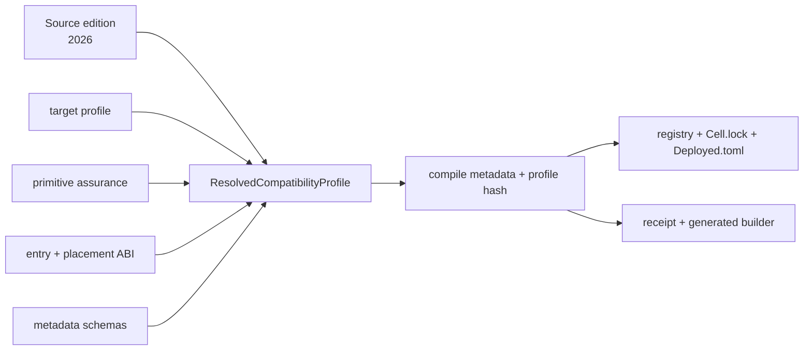

# CellScript Edition Policy

**Status**: Edition 2026 remains the default; both editions use the alpha.2
inference-only effect contract. Integration and release acceptance are pending.

CellScript editions are long-lived source-language semantic epochs. An edition
answers one question: how should this CellScript source be understood? The year
in an edition label is an identifier, not an annual release schedule. Edition
2026 may remain current across multiple compiler release years.

The stable supported edition is:

```toml
[package]
edition = "2026"
```

`edition` is mandatory in every package manifest. A missing or unknown value is
an error. The current compiler records
`cellscript-source-semantics-2026-0.33-effect-facts-v1` or
`cellscript-source-semantics-2027-0.33-effect-facts-v1`. Both derive effects
from operations and resolved callees; source effect declarations are rejected.
Earlier source-semantics identities belong to historical artifacts and are not
accepted by current artifact readers. Rebuild from source; no compatibility
reader or annotation migration mode is provided. See the
[effect contract](CELLSCRIPT_EFFECT_CONTRACTS.md).
Its separately routed authoring frontend
shares Edition 2026's full declaration, value, and statement grammar and
preserves their checked meaning.
The `verification` marker is optional in ordinary action/lock bodies; the
formatter currently retains the established explicit-marker form. Multiple
source actions and locks are allowed, but compiled artifacts still select one
entry. This is not shared-policy dispatch. Its retained bounded native subset is
specified in [the Edition 2027 preview grammar](CELLSCRIPT_2027_PREVIEW_GRAMMAR.md).

The [authoring target adopted on 2026-09-05](CELLSCRIPT_AUTHORING_TARGET.md)
guides the next frontend iteration. It preserves the Edition 2026 authoring
vocabulary and requires genuine multi-action operation under one deployed
policy. `authoring1` advanced source and cache identities for the restored
authoring surface while keeping the native preview4 grammar and existing wire
ABIs. The accepted 0.30 identity includes precise `ScriptHash` successor-lock
contracts, bounded schema acknowledgements, explicit persistent-policy dispatch,
typed runtime views, and authenticated openings. The capability ledger and
release notes define the finite accepted scope. The
[implementation checklist](CELLSCRIPT_AUTHORING_IMPLEMENTATION.md) records the
full goal and its evidence requirements.

`cellc migrate --to 2027` is a bounded review tool, not a migration promise.
It recognizes only the existing self-contained bounded legacy Type/Lock shapes.
Type Script candidates retain ordinary `action` authoring and absolute Cell
locations; their conversion to native group ports is not an equivalent rewrite.
The tool preserves source outside the final entry, and emits no
candidate unless `CoreSemanticId` and RISC-V ELF bytes match. It never changes
`Cell.toml`, `Cell.lock`, deployment state, or source files by default.

## What The Edition Owns

An edition owns rules that can change the meaning of the same source text:

- keywords, reserved words, and resolution of syntactic ambiguities;
- name resolution, scope behavior, and the default prelude;
- type checking, inference defaults, coercions, and flow/resource rules;
- desugaring and other source-observable semantics; and
- edition-specific deprecation diagnostics and migration lints.

Edition 2026 and Edition 2027 have distinct source-semantics identities.
Both lower through the shared checked AST/IR into typed-semantics v10 and
may have identical
`CoreSemanticId` values for the explicitly equivalent subset. Absolute
transaction locations and current-group locations are not such an equivalent
subset. Correcting physical binding records does not redefine deployed bytes.
Preview4 admits
one final native `type_script` or `lock_script` container; it does not admit
both in one source module. Its bounded Type Script surface distinguishes
successor, fixed-role pooled accounting, retirement, and fresh output origin,
and its `audit` surface is metadata-only by construction. These native-container
restrictions do not apply to ordinary authoring modules. Existing terminal
`consume`/`consume_each` operations retain their legacy semantic records; they
are not reinterpreted as explicit retirement or native pooled accounting.
Default parameters keep their existing type-directed entry provenance,
including read-only references. Provenance remains distinct from authorization.

Additive syntax, diagnostics, formatter improvements, and optimizer changes do
not require a new edition when existing source keeps its meaning. A new edition
is justified only when an intentional source-semantic break cannot be handled
by an additive feature, a warning/deprecation cycle, or an independently
versioned schema or ABI.

## Independent Compatibility Axes

The edition does **not** own the compiler release, target profile,
primitive-assurance mode, metadata schemas, or CKB wire ABIs. The compiler
assembles those independently versioned values with the source edition into a
resolved compatibility profile:

| Axis | Current implementation value |
|---|---|
| Source edition | default `2026`; opt-in bounded `2027` |
| Source semantics | `cellscript-source-semantics-2026-0.33-effect-facts-v1` or `cellscript-source-semantics-2027-0.33-effect-facts-v1` |
| Compiler release | workspace SemVer (`0.x.y`), recorded separately |
| Target profile | selected independently, normally `ckb` |
| Primitive assurance | selected independently, or `default` |
| Payload ABI | Single entry: `cellscript-entry-witness-v1` (`CSARGv1\0`); explicit Type policy: `cellscript-policy-witness-v1` (`CSPOLv1\0`) |
| Placement ABI | Single entry: `cellscript-witnessargs-input-type-v2`; explicit Type policy: `cellscript-policy-witnessargs-input-type-v1` |
| Metadata schemas | metadata 74, source 2, artifact 1, constraints 4 |

The compiler release is recorded next to the profile but is not part of the
profile itself. A compiler patch may change diagnostics or optimization
without changing compatibility. Conversely, an urgent wire-ABI or metadata
fix can advance its own version immediately without waiting for a new calendar
year or source edition.

Policy selection is explicit and changes the entry compatibility profile, not
the source edition or inner CSARG argument bytes. The
[policy witness ABI](CELLSCRIPT_POLICY_WITNESS_ABI.md) defines its bounded
multi-record ownership and exact current Script-hash selection. Unselected
builds retain the single-entry profile even if a package declares policies.

For the current single-entry CKB placement profile:

| Contract | Value |
|---|---|
| Placement field | `WitnessArgs.input_type` |
| Witness source | `GroupInput#0`, then `GroupOutput#0` |
| Raw payload alias | rejected |

The resolved profile uses schema
`cellscript-resolved-compatibility-profile-v1`. It is emitted in compile
metadata and hashed into package, registry, lockfile, deployment, receipt, and
generated-builder identities. Changing any constituent axis changes the
profile identity even when source text and edition stay the same.



Registry records therefore retain both `edition` and
`compatibility_profile_hash`. The former tells source consumers how to read the
package; the latter commits to the complete compile/build contract. A registry
consumer must not infer target, primitive, ABI, or metadata versions from the
edition year.

## Why `CSARGv1` Still Exists

The source edition and `CSARGv1` solve different problems.

- `edition = "2026"` selects source-language meaning before a transaction
  exists.
- `CSARGv1\0` identifies CellScript positional-argument bytes while a CKB
  Script is executing.
- `cellscript-witnessargs-input-type-v2` identifies where those bytes are
  placed and how the script-group witness is selected.

The current compatibility profile combines all three identities. The old raw
placement form—putting `CSARGv1` directly in the witness instead of inside a
canonical `WitnessArgs.input_type`—is not accepted. It fails closed with
runtime error `25 entry-witness-abi-invalid` because the placement ABI says so,
not because calendar year 2026 intrinsically implies a witness layout.

## Persisted Format Boundary

The 0.23 line deliberately starts new persisted identities:

| Surface | Required identity |
|---|---|
| Compile metadata | metadata 57, source 2, artifact 1, constraints 2 |
| Compatibility profile | `cellscript-resolved-compatibility-profile-v1` with every independent axis |
| `Cell.lock` | version 2 |
| `Deployed.toml` | version 2 and `cellscript-deployed-v0.23-edition-2026` |
| Compile receipt | `cellscript-compile-receipt-v3` |
| Generated action builder | `cellscript-generated-action-builder-v0.23-edition-2026` |

Readers reject earlier versions. They do not silently fill edition/profile
fields or rewrite old files.

The alpha.2 fact-protocol cutover supersedes the affected rows above: metadata
74 (source 2 / artifact 1 / constraints 4), compile receipt v4, package interface
v5, and the current edition-specific `0.33-effect-facts-v1` source identities
are required. Old effect/interface/receipt readers are removed; rebuild the
complete source/bundle instead of translating it. The complete current identity
table is in [the effect contract](CELLSCRIPT_EFFECT_CONTRACTS.md). Historical
format allocations above do not describe an accepted reader or compatibility mode.

The 0.24 line advanced the lock carrier to version 3. The 0.30 development
line advances it to version 5 with schema
`cellscript-lock-v0.30-single-package-coordinate-v1`, binding the root and every
dependency's compiler range plus the compiler release that resolved the graph.
It also declares the `single-package-coordinate-v1` resolver model.
This is a dependency-resolution and source-tool compatibility change, not a
new source edition: Edition 2026, the compatibility profile, `Deployed.toml`,
receipt, and generated-builder identities remain independently versioned.
Build/check/test reject older locks; only explicit `cellc lock` or
`cellc update-plan` may propose a repin and `cellc update --apply-plan` may
apply the reviewed receipt.

## API Boundary

Package compilation reads the mandatory edition from `Cell.toml`. APIs without
a package manifest must receive the edition explicitly:

- native metadata-only Rust APIs take `CellScriptEdition`;
- WASM exports take an edition string and accept `"2026"` plus the `0.26b`
  experimental `"2027"` value;
- browser workers pass `"2026"` explicitly; and
- LSP package compilation resolves the nearest package manifest.

`CompileOptions::default()` uses the current edition only for in-memory and
standalone compiler use. It is not a fallback for a package missing `edition`.

## Release And Evolution Requirements

Different axes have different closure requirements:

- source-semantic changes require a new edition plus parser, formatter, type
  checking, lowering, metadata, LSP, migration diagnostics, docs, and tests;
- entry or placement ABI changes require a new ABI identity plus codegen,
  builder, metadata, CKB-VM, `backend`, `dev`, and `ci` evidence;
- metadata changes require a schema bump plus every reader/validator update;
- target and primitive changes retain their own profile and gate contracts; and
- compiler-only compatible improvements use ordinary SemVer releases.

No edition is created merely because a year or compiler release changed.

## Source editions and retired wire generations

Edition 2026 and Edition 2027 are supported authoring policies over a shared
syntax/statement kernel. Edition 2027 also has a bounded native container
surface. Keeping these routes does not admit retired effect declarations or
metadata: both use the current inferred-fact source profile and reject retired
protocol generations. The private Edition 2026 route is named for its edition,
rather than presenting the default parser as a migration shim.

Implicit entry selection and explicit artifact policies describe different
execution/dispatch contracts. `IrEntrySelection::Implicit` names the current default selection directly.
The enum is not serialized into metadata, interfaces or witness protocols;
producer/consumer matches and entry-selection tests were audited for the rename.
There is no alias for the retired Rust variant name and no old wire reader.

Stack collections, arena-owned collections and borrowed/nested views have
different ownership, storage, bounds and invalidation evidence. They remain
separate models for those reasons. A decoded nested slice grants no transaction
or lifecycle authority; local slice inspection must not invent a transaction
read. These distinctions are independent of source editions and wire versions.
