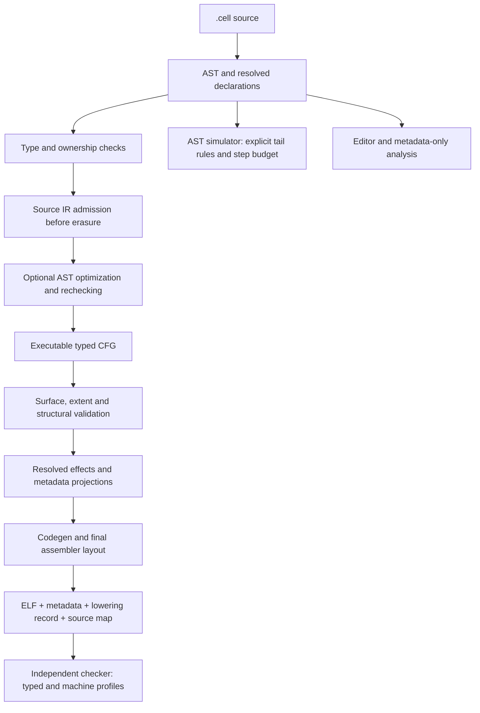

# CellScript IR contract

This document describes the compiler-owned intermediate representation and its
consumers on development branch `0.36`. It records the consistency work in
[issue #105](https://github.com/CellScript-Labs/CellScript/issues/105).
The [layout and lowering contract](CELLSCRIPT_LAYOUT_LOWERING_CONTRACT.md)
continues to own the machine argument, storage and assembler decisions from
issue #104.

The IR is a typed control-flow graph with mutable local storage, structured
domain operations and retained declaration evidence. It is a hybrid
representation, rather than a claim that every operation is in static single
assignment form. That design fits bounded Cell operations, explicit runtime
helpers and a small backend, provided each phase preserves the distinctions
described below.

## Phase ownership

| Layer | Owner | Authoritative facts and responsibilities |
| --- | --- | --- |
| Source syntax | `lexer`, `parser`, `ast`, `frontend` | Source expressions, statements, declarations, spans and generic provenance |
| Resolution and checking | `resolve`, `types`, `flow` | Declaration identity, admitted type applications, source typing, ownership and source control-flow rules |
| AST optimization | `optimize` | Conservative rewrites that preserve lexical scope, contextual types, effects and observable failure |
| Executable lowering | `ir` | Typed locals, blocks, terminators, physical Cell bindings, selected runtime helpers and executable domain operations |
| IR admission | `executable_surface`, `ir/validate` | Supported executable types and operations, checked fixed extents and the bounded structural checks below |
| Effects and review projections | `effects`, `proof_plan`, `typed_semantics`, `metadata_build` | Reconstructed resolved effects and explicit projections of the admitted IR into review records |
| Machine lowering | `codegen`, `assembler` | Argument transport, frame storage, helper emission, instruction layout, ELF and machine evidence |
| Independent admission | `cellscript-artifact-checker` | Independent wire parsing, typed-record reconstruction and supported machine-profile verification |
| Development consumers | `simulate`, LSP, WASM | Their stated execution or analysis subset; none inherits stronger evidence merely by using the compiler library |



The full compile pipeline checks source lowering before optional optimization
can erase a declaration or invalid body. It rechecks an optimized AST, lowers
the selected source, scopes the entry and reconstructs effects. Representation
optimizations must preserve those resolved effects. Executable admission then
checks the result before metadata and machine emission.

This sequence does not make every consumer an IR interpreter. The simulator
still interprets the AST. LSP analysis and the browser metadata-only path retain
their own bounded responsibilities. In particular, the browser summary does
not carry the native verified-artifact proof surface.

## A mutable CFG, with retained declaration evidence

An `IrBody` contains basic blocks. Each block has instructions followed by a
`Return`, `Jump` or conditional `Branch` terminator. `IrVar` retains an ID, a
diagnostic name and a structured type. Many temporary results have one
definition, but mutable bindings and loop updates can write an existing local.
A local ID therefore identifies a location in the compiler's representation;
it is not universally an SSA value version.

For example, `let mut count = 0; count += 1` describes one mutable source
binding. A backend may reuse its backing location. A general SSA design would
instead introduce new value versions and merge them with explicit phi nodes
or block arguments. CellScript does not currently require that conversion.
Optimizations must use the actual mutable-location contract when tracking
values and invalidating facts.

Some declaration records deliberately retain AST expressions.
`IrValidityPredicate`, for example, keeps the predicate expression, its source
span, rendered description and evidence classification. These are reusable
declaration templates and audit evidence. Executable use must bind the template
to the selected typed values and lower its checks into instructions and
failure paths. A rendered predicate string does not authorize execution, and
retaining a template does not make source text the backend's instruction set.

This distinction permits useful source evidence without requiring every
declaration to be converted into executable blocks before it has an applicable
value or entry scope.

## Types and call targets preserve identity

Type applications, context views, nested views, commitments and openings keep
their structured representations through internal consumers. Imported nominal
types keep declaration identity even when two records have equal widths.
Resolution uses one AST-to-IR type conversion for the affected declaration and
field paths; a second partial conversion must not silently omit a type family.

Function and runtime targets have different provenance:

| Internal target | Meaning | Allowed interpretation |
| --- | --- | --- |
| `IrCallTarget::Function(symbol)` | A resolved ordinary definition | Look up that definition's parameters, return type and effects |
| `IrCallTarget::Runtime(helper)` | A selected registered intrinsic | Dispatch over the typed `RuntimeHelper` and its explicit contract |
| `IrCallTarget::InvalidRuntime(symbol)` | An unresolved internal runtime request | Reject compilation |

An ordinary function named `__ckb_commitment_open` remains an ordinary
function. Its spelling cannot give it authenticated-opening semantics,
runtime failure behavior or a checked-runtime ProofPlan. Compiler-side plan
construction selects `RuntimeHelper` variants. At the wire boundary, the
checker first distinguishes `typed-local` from `versioned-runtime-helper`,
checks local closure and signatures, and applies specialized helper rules to
the runtime contract.

The exact ZK parent profile retains its direct action-entry boundary. An action
that owns an authentic ZK runtime call cannot be entered as an ordinary callee
from another action or helper. Compiler IR admission and independent typed-call
graph admission both reject that edge until a nested-call profile is defined.
An ordinary function with a runtime-looking label does not establish ZK
ownership.

There is also a narrow reserved **type** namespace. Exact prelude labels with
compiler-owned physical representations cannot be reused by source type
declarations or imported type aliases. This includes the registered temporal
scalar labels, `ScriptHash`, `SighashAllDigest`, the fixed ZK proof type,
`ExactScriptHandle` and `DeploymentLineHandle`. Conflicts produce `E2111`
before inference can assign a builtin representation to a source record.

The reservation is defined by `is_reserved_builtin_type_name` in
[`src/ir/mod.rs`](../src/ir/mod.rs). It does not reserve every prelude-looking
name, substring or function label. Ordinary record names such as `OutPoint`
remain available, and function imports do not acquire type-namespace rules.
This is a specific source compatibility restriction, not a fully separate
builtin-type ID system.

## Syntax, optimization and simulator behavior

The same expression can have different roles depending on its source position:

```cell
fn value() -> u64 { 7 }

action run() -> u64 {

        value();
        require false;
        return 0;
}
```

`value()` is an ordinary statement here. Its result is discarded, and the
later `require` must execute and fail. It must not become an implicit return
because its evaluated value is non-unit.

A final expression in a callable with a declared return type can supply its
return value. A final `if` propagates that context into its branches; a value
block evaluates its final expression. Ordinary loop bodies and intermediate
branches do not gain implicit-return semantics. Explicit `return`, `break` and
`continue` retain their separate control-flow roles.

AST rewrites must preserve lexical scope and contextual types. A constant
statement `if` is retained as a scoped statement instead of splicing its
branch into the surrounding statement list. The IR may still use its literal
condition when determining effective reachability. Wide unsigned negation
must retain its checked failure behavior when constant folding would otherwise
erase the operand's `u128` context. Equal-looking successful values alone are
insufficient grounds for a rewrite that changes failure.

The simulator executes every element of an ordinary supported `for` and
continues a `while` until its condition, explicit control flow or configured
step budget stops it. The former ten-element and hundred-iteration caps are
removed. Each iteration consumes budget, including empty bodies. Exhaustion
returns `StepLimitExceeded`; it does not report a successful partial run.
Field evaluation propagates runtime and budget errors instead of replacing
them with placeholder values.

These repairs improve local development feedback. They do not expand the
simulator into a CKB-VM implementation. Its
[scenario evidence remains non-consensus](CELLSCRIPT_EXECUTABLE_TEST_SCENARIOS.md),
and unsupported or simulated operations retain their stated limitations.

## Encoded width, call transport and storage are different queries

The IR contract does not require one number to describe all layouts:

| Query | Question it answers | Example distinction |
| --- | --- | --- |
| Encoded or fixed-value width | How many bytes encode the admitted value? | A `Commitment<T>` has a 32-byte digest; an `Opening<T>` retains a length-delimited witness/span contract |
| Machine argument layout | Which ABI words or outgoing stack slots transport the value? | A fixed byte value may travel as pointer and extent rather than one scalar word |
| Physical storage plan | Which frame region holds the value and for how long? | Backing bytes and scalar local slots have different extents and alias relationships |
| Schema or dynamic codec | How are admitted fields or variable extents encoded? | A nominal record requires its resolved field layout; a dynamic collection has no intrinsic fixed width |

The intrinsic fixed-layout query checks arithmetic and representable extents;
it does not resolve every nominal record or dynamic codec. The callable layout
and frame planner consume admitted types and their own contracts. Equal wire
width is not nominal type equality, and equal argument word count is not proof
of equal backing storage. See the
[layout contract](CELLSCRIPT_LAYOUT_LOWERING_CONTRACT.md) for the machine-level
classification and its compatibility decisions.

## What the structural verifier checks

The compiler's structural verifier runs through executable type admission,
including the codegen entry point for directly supplied IR. It rejects
contradictory graph and local descriptions with `E2105`.

| Checked invariant | Reason |
| --- | --- |
| Each callable has a nonempty block set with unique block IDs | The entry block and graph nodes must exist unambiguously |
| Jump and branch targets exist in that callable | Emission must not follow a missing block |
| Branch operands are boolean variables or boolean constants | A CFG condition must retain its typed contract |
| Parameter binding IDs are unique and agree with their declared types | Parameters must describe consistent local bindings |
| Repeated descriptions of a local agree by resolved backing type | A reused local ID cannot silently change physical meaning |
| Nominal declarations and aliases do not impersonate reserved builtin types | Direct IR must preserve the source admission boundary |

References are compared through their backing type for this local consistency
check: `Ref<T>` and `MutRef<T>` can describe views sharing the same storage as
`T`. That comparison does not prove borrow lifetimes or permission to mutate.
An untyped empty vector may refine from `Vector(None)` to one concrete element
type; two conflicting concrete element types still reject.

This is a bounded structural verifier. It does **not** prove dominance,
definition-before-use on every path, complete instruction type rules, arbitrary
call correctness, source equivalence or general allocation safety. A mutable
local may have several writes, so a universal single-definition rule would be
incorrect. Source checking, executable-profile validation, backend invariants
and independent artifact checks retain their respective responsibilities.
Passing two phase checks is not a blanket justification for every `unwrap` or
`expect`; each such use still needs a local invariant.

## Independent evidence and caching

Internal IR is compiler-owned and is not the persistent bundle format. The
cache stores artifact bytes and versioned metadata/lowering/source-map records;
it does not restore an executable internal IR or a source AST snapshot. A cache
hit reconstructs the result and validates it. Unsupported record versions are
rejected rather than accepted merely because the cache key matches.

The cache key includes source-set identity, compiler and metadata identities,
options, checker identity, lowering-record version and source-map version.
Generation `project-source-set-v200-ir-semantic-consistency` also invalidates
artifacts produced before these semantic repairs. A compiler behavior change
that preserves public schema versions still needs an intentional generation
change when it can invalidate cached results. An internally consistent old
artifact cannot advertise which newer compiler policy should have produced it.

The standalone checker does not import compiler IR or reuse its inference and
emission algorithms. It reconstructs typed facts and verifies supported machine
profiles independently. Shared closed vocabulary describes a contract; it is
not evidence that a helper's machine body satisfies that contract.

Generic ProofRecords provide obligation IDs, owners and evidence-tier links.
Their existence does not independently prove arbitrary business predicates.
Some profiles add substantive checks: trusted external verification binds the
declared identity to its exact hash-check/delegation sequence, and checked spawn
claims bind authorization and invocation to machine checks. Evidence strength
therefore depends on the particular verified profile and its stated limits.

Similarly, a canonical typed-semantic identity binds its documented projection;
it does not establish arbitrary machine equivalence, optimizer equivalence or
transaction acceptance. See the
[semantic foundation](CELLSCRIPT_SEMANTIC_FOUNDATION.md) and
[verified-artifact boundary](CELLSCRIPT_VERIFIED_ARTIFACT_BOUNDARY.md).

## Before and after issue #105

| Layer | Before | Behavior after the repair |
| --- | --- | --- |
| Resolver-to-IR conversion | A separate field conversion could omit newer type families | Affected fields and declarations use the shared structured conversion |
| Type namespace | A source record or alias could collide with a builtin representation label | Exact reserved representation names reject with a targeted source diagnostic |
| AST optimization | Constant statement branches could lose scope; wide negation could lose type-dependent failure | Scope and checked arithmetic context remain visible to lowering |
| IR admission | Surface/type admission lacked the added common CFG/local consistency pass | Malformed block links, boolean conditions and conflicting local descriptions reject before emission |
| ProofPlan construction | Some helper plans selected semantic meaning from the rendered call label | Plans select the retained runtime target |
| Checker call admission | Some specialized helper rules ran before source/runtime contract dispatch | Local callee closure is checked separately from runtime helper rules |
| Simulator statements | Any non-unit expression statement could stop the callable early | Intermediate values are discarded; supported tail positions still return values |
| Simulator loops | Ordinary loops could report success after a fixed partial traversal | Full supported traversal or an explicit budget error |
| Simulator field evaluation | A field error could become a placeholder value | Runtime and step-budget failures propagate |
| Persistent cache | A prior-generation artifact could survive a same-version semantic repair | Generation v200 invalidates prior results and schema versions participate in key identity |

The table describes implementation responsibilities and expected behavior. It
does not assert that gates, CI or release acceptance have run. Validation
receipts must identify their commands, snapshot and actual results separately.
The [issue #105 acceptance record](reports/0.36/ISSUE_105_ACCEPTANCE.md)
retains the focused runs and corrected failures.

For authors, the practical change is earlier and more specific feedback.
A conflicting type alias is a source error naming that alias. An ordinary
runtime-looking function is checked against its own signature instead of
failing an unrelated authenticated-helper rule. Direct IR consumers receive a
structural diagnostic for the covered malformed shapes. Simulator users see a
later failed requirement or an explicit budget error instead of a misleading
successful partial trace. A budget error calls for inspecting termination or
choosing a deliberate larger budget; it does not imply successful execution.

## Glossary

| Term | Meaning here |
| --- | --- |
| AST | Abstract syntax tree: the parsed source structure, before executable lowering |
| IR | Intermediate representation: the compiler-owned typed executable graph and associated declaration evidence |
| Lowering | Converting a higher-level construct into operations with more explicit execution or machine obligations |
| CFG | Control-flow graph: blocks connected by jumps and conditional branches |
| Basic block | A sequence of instructions with one terminator controlling its successor |
| SSA | Static single assignment: a representation in which each value version has one definition |
| Mutable local | A local storage identity that may receive several writes |
| Dominance | A graph relation in which every path to a block passes through another block; useful for checking value availability |
| Nominal identity | Type identity derived from the resolved declaration, rather than equal spelling or width |
| Provenance | Retained evidence of where a type, target, value or claim came from |
| Tail expression | A final expression whose enclosing source context permits it to provide a value or implicit return |
| ABI | Application binary interface: the contract for transporting parameters and results across machine calls |
| Wire schema | The versioned externally readable structure of metadata or sidecar records |
| ProofPlan | An explicit review plan connecting an obligation, scope, evidence tier and coverage; its name alone is not a proof |
| Machine profile | A bounded implementation pattern independently admitted by the artifact checker |
| Step budget | The simulator's explicit execution bound; exhaustion is an error |
| Cache generation | An internal compiler policy identity used to invalidate otherwise schema-compatible cached products |
