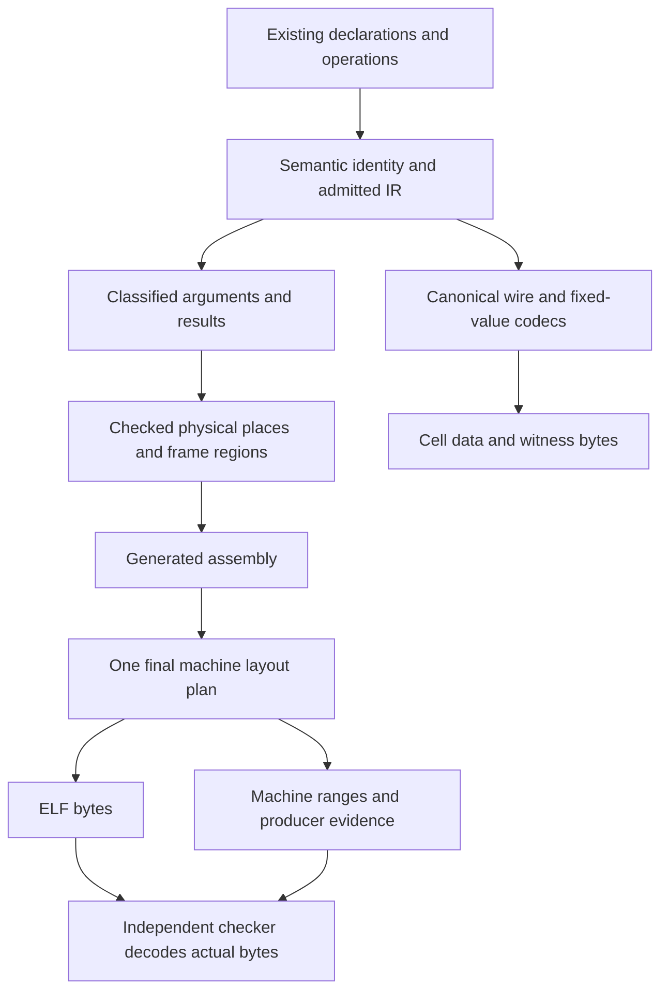
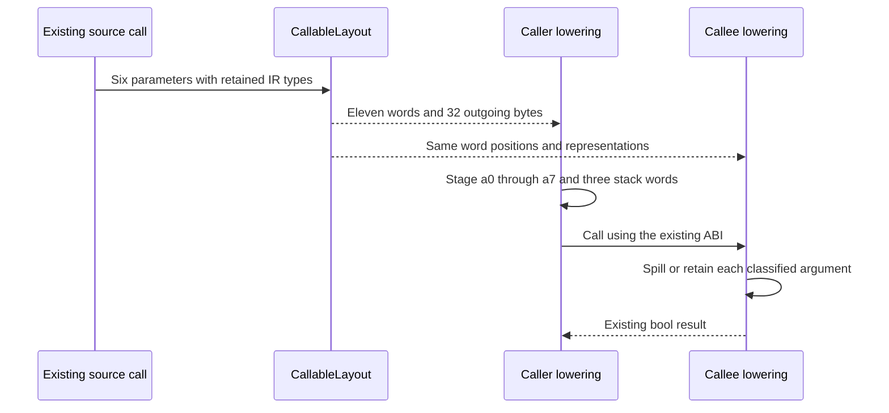
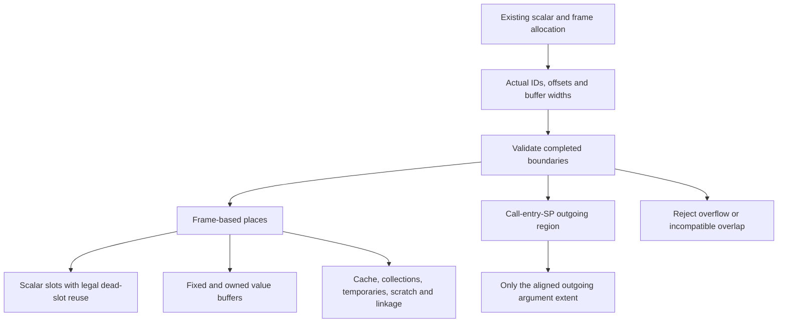
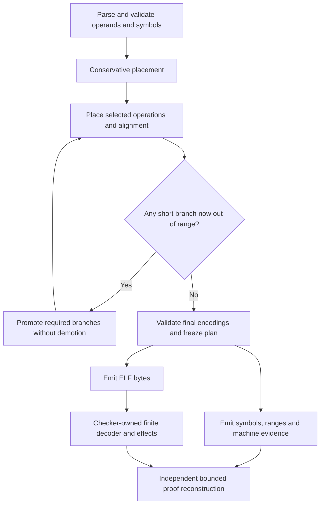

# Layout and lowering contracts

This document explains the implementation boundary for
[issue #104](https://github.com/CellScript-Labs/CellScript/issues/104). The
`0.36` development branch starts at `0.35` commit
`c31e31754ac455ea3f071d21efd1ea05af4ec378`. The branch name does not change
the Cargo version, publish an artifact or establish production acceptance.

The candidate introduces explicit compiler-owned call, storage and machine
plans, independent checker instruction effects, and corrections to standalone
public generators. Ordinary source syntax and public wire schemas retain
their existing boundaries. Technical verification of A01-A15 is complete within the stated scope:
1,193 complete-library tests and 405 tests across all eleven release-profile
integration targets passed. The [acceptance record](reports/0.36/ISSUE_104_ACCEPTANCE.md)
retains source phases, earlier failures and the interrupted duplicate debug
profile. Two early GPG pinentry timeouts were resolved by successful signed
source commits; both signatures verify as `G`, and unsigned fallback was never
used. The signed source changes are:

- Independent checker: [7c203840c56e80110ae6d05b2f79b82806ec7633](https://github.com/CellScript-Labs/CellScript/commit/7c203840c56e80110ae6d05b2f79b82806ec7633).
- Backend and standalone stdlib: [24f4e02d0a431d0aa9c72dcbd5cab982900656bb](https://github.com/CellScript-Labs/CellScript/commit/24f4e02d0a431d0aa9c72dcbd5cab982900656bb).

The final executable source matches the retained `4c15...` manifest's
751-input audit at the latter commit. Evidence-only documentation commits keep
that tested code identity separate from their own Git hashes. Consult
[issue #104](https://github.com/CellScript-Labs/CellScript/issues/104) for the
published branch head and issue-closure record; test results do not imply
those lifecycle operations. Gates and CI are excluded by the maintainer's
instruction for this work.

## Five contracts with separate meanings

An author can pass a sixteen-byte value without knowing whether the compiler
uses a pointer, registers or a local buffer. Keeping that convenience requires
several different compiler decisions to agree.

| Contract | Question answered and existing owners | What it does not establish |
| --- | --- | --- |
| Semantic identity | What value, declaration owner and source role does this mean? `resolve/identity.rs`, `types/`, structured `ir::IrType` and `ir/nested.rs` retain that information. | Equal display names or encoded widths do not manufacture nominal equality or Cell authority. There is no parallel TypeId hierarchy. |
| Wire and fixed-value encoding | Which bytes encode the value, with which field offsets and bounds? `ir/fixed_layout.rs`, admitted field layouts, data/entry codecs and generated builders own this contract. | This is not host Rust `size_of`. A fixed-width query that follows a reference describes the referenced value, not the machine size of its pointer. |
| Executable value and physical storage | Where are an actual scalar, addressed buffer, borrowed view, cache or scratch region stored? `codegen/layout/storage.rs`, `frame.rs`, `scalar_slots.rs`, `value_returns.rs` and bounded collection owners describe these places. | A semantic local ID is not a physical offset. A slot containing a pointer does not own every byte reached through it. |
| Calling ABI | How do arguments and results cross this function boundary? `CallableLayout` and `ParameterRepresentation` in `codegen/layout.rs` are consumed by `calls.rs`, `frame.rs` and `abi.rs`. | This is CellScript's custom ABI, not Rust/C ABI compatibility or permission for borrowed data to escape. |
| Machine layout | Which final addresses, padding and instruction expansions produce the ELF? `codegen/assembler.rs` and `codegen/assembler/layout.rs` own these coordinates. | Instruction offsets, virtual addresses and ELF file offsets are different quantities. A producer's plan is not independent checker authority. |



Read the two paths separately. The wire path describes bytes an application
stores or supplies. The executable path explains how the program handles those
bytes internally. The checker receives the artifact and its evidence, then
reconstructs admitted machine facts independently; it does not reuse the
compiler's layout query as a proof.

These plans evolve existing owners. They do not add serializable public
layout records, replace source identity or introduce a second allocator.
Allocation policy remains in the scalar/frame owners. This work does not
claim a general allocation optimum, complete control-flow integrity or complete
source-to-machine equivalence.

## What changes for an author, builder or editor

| Developer task | Previous risk addressed by this work | Candidate behavior and retained boundary |
| --- | --- | --- |
| Extract a helper with several wide parameters | Caller, callee and entry code could classify expanded words independently. | They consult the same classified call layout and check their word cursors. The source signature stays unchanged. |
| Return a fixed record, then call another helper | Encoded width, hidden result pointer and backing storage could be confused. | Explicit result transport keeps the caller-owned buffer distinct from outgoing arguments and later scratch. This preserves existing admitted returns. |
| Pass typed Cell or nested read-only views | A helper must retain identity, bounds and the backing lifetime. | Existing structured descriptions remain authoritative. The plan grants no lifecycle ownership, mutable escape or arbitrary recursive views. |
| Generate witness bytes | Internal pointer/length transport could be mistaken for public encoding. | Existing native/generated codecs keep producing canonical value bytes. This work adds no serializer, signer or SDK entry feature. |
| Diagnose malformed generated assembly | Separate sizing/encoding paths could disagree or lose an error's origin. | The parsed plan retains generated line, text, section and operation; errors identify that boundary. |
| Call the standalone legacy generator | Descriptor-only or placeholder behavior could appear successful. | Corrected buffer contracts and explicit non-returning rejection apply as documented below. This is an intentional public API behavior correction. |

A source error still belongs to the parser, type/lifetime checker or admitted
runtime profile. A compiler-owned plan inconsistency is a compiler error; an
author should not need dummy locals, register annotations or hidden pointer
parameters to work around it.

### Typed read-only helpers keep their syntax

The existing [typed predicate](../examples/language/ckb/typed_cell_predicate.cell)
uses:

```cellscript
fn matches(before: InputView<Token>, after: OutputView<Token>) -> bool {
    return ((before.data.id == after.data.id)) && ((before.data.owner == after.data.owner));
}

fn forward(before: InputView<Token>, after: OutputView<Token>) -> bool {
    return matches(before, after);
}
```

Its caller selects input 1 and output 0. These helpers compare fields; a true
result is not a complete settlement policy and grants no right to consume or
create Cells. The custom view ABI implements this existing read-only
composition.

### Wide arguments count machine words, not source parameters

The [non-financial fixture](../tests/fixtures/document_product_sum_relation.cell)
contains this existing signature:

```cellscript
private fn check_document(index: u64, a: u128, b: u128, denominator: u128, quotient: u128, remainder: u128) -> bool {
    let revision = ckb::input::<Document>(index).data.revision;
    return (revision == 7) && exact_relation(a, b, denominator, quotient, remainder);
}
```

Here `index` takes one machine word and each `u128` uses a pointer/exact-length
pair. Six source parameters expand to eleven machine words:

| Source part | Word positions | Transport |
| --- | --- | --- |
| `index` | 0 | a0 |
| `a` pointer / length | 1 / 2 | a1 / a2 |
| `b` pointer / length | 3 / 4 | a3 / a4 |
| `denominator` pointer / length | 5 / 6 | a5 / a6 |
| `quotient` pointer / length | 7 / 8 | a7 / call-entry stack byte 0 |
| `remainder` pointer / length | 9 / 10 | call-entry stack bytes 8 / 16 |

Three stack words occupy 24 bytes. The outgoing reservation rounds to 32 bytes
to retain 16-byte stack alignment. This does not replace external `u128`
witness bytes with guest pointers.



The plan is built during compilation, not negotiated at runtime. Both sides
check the positions and count they consume, so an inconsistent lowering change
reports the phase, callee and expected/actual word boundary.

### A record result has its own object

The embedded `wide_arguments` source in
[`tests/value_return_abi.rs`](../tests/value_return_abi.rs) defines:

```cellscript
struct Totals { total: u128, first: u128, }
fn sum_wide(a: u128, b: u128, c: u128, d: u128, e: u128) -> Totals {
    let left = a + b;
    let right = c + d;
    let subtotal = left + right;
    return new; new Totals { total: subtotal + e, first: a, };
}
```

Its ten ordinary words are followed by the hidden caller-owned result pointer
at word 10, call-entry stack byte 16. The result buffer occupies 32 bytes. The
outgoing argument reservation also occupies 32 bytes, but they are separate
objects. The author keeps writing `let result = sum_wide(...)`.

`ReturnLayout` keeps entry status, annotated entry values, unit, a single
word, wide pairs, encoded pairs, tuples and caller-owned results distinct.
Return guards compare the actual operand's classified transport in both
directions and reject an absent required value. Annotated entry values retain
their existing behavior; an ordinary function's hidden result argument is not
automatically added to an entry wrapper.

Equal transport width also does not merge argument objects. For example, the
current `FixedAggregate` and `FixedBytes` classifications each occupy two
words but retain their distinct meaning and established emitted descriptions.

### Nested views retain their admitted limits

The [nested migration example](../examples/language/batches/nested_migration.cell)
declares `Messages` with eight items, 256 payload bytes per item and 2,120
encoded bytes, then uses `Messages::Item`, indexing and helper calls:

```cellscript
fn same_message(before: Messages::Item, after: Messages::Item) -> bool {
    if before.len() != after.len() { return false; }
    for i in 0..before.len() {
        if before[i] != after[i] { return false; }
    }
    return true;
}
```

Encoded offsets, borrowed views and owned materialization remain different
representations. The refactor reuses structured nested descriptions from
[issue #91](https://github.com/CellScript-Labs/CellScript/issues/91). It does
not admit arbitrary recursion, mutable escaping views or every possible
helper fast path.

The frozen compatibility control compiles six ordinary programs at default
and unoptimized diagnostic settings: twelve ELF/checker records. These are
internal diagnostic settings, not newly exposed optimization levels.
Baseline and candidate receipts remain separate.

## Physical storage: checked places over the existing allocator

`FunctionStoragePlan` owns the actual scalar offset map, fixed/named
locations, hidden result-pointer slot and exact-read cache offset. A recorded
`StoragePlace` is frame-relative and retains offset, extent, actual alignment,
ownership and kind. `StorageRegion` additionally records its frame/outgoing
coordinate base and distinguishes scalar storage, cache,
collections, expression temporaries, scratch, linkage and outgoing arguments.
The frame builder supplies the actual boundaries to `finish` after
preparation; a default 16-byte frame is not treated as a prepared plan.



This is an ownership diagram, not an exact stack-address drawing. The outgoing
area uses a different coordinate from caller-local entry payloads or result
buffers.

Validation preserves compatible aliases: scalar locals whose lifetimes permit
reuse may share one whole eight-byte slot; an explicitly recorded fixed-buffer
alias may share its owner's whole extent. Zero-width objects grant no
dereference. Arbitrary partial overlap, a forged cache location and overlap
with protected regions reject. Collection bytes describe the actual collection
reservation, not every allocation after the cache.

The validator records allocation rather than redesigning it. It retains
checked physical maps for actual IR IDs, including unoptimized identity
placement, without treating `local_id * 8` as a universal buffer extent.
Collision checking sorts the places and scans compatible alias groups rather
than comparing every scalar pair. Recorded alignment describes the slot or
buffer's address relative to aligned SP, not the alignment or ownership of a
stored pointer's referent.

## One final machine plan and independent machine facts

The assembler parses generated text once, retaining line/section/operation
provenance and selected immediate plans. `MachineLayoutPlan` freezes
instruction expansion, symbols, padding, branch choices, CFG coverage and
metrics. ELF bytes and machine evidence consume that same plan.



Alignment can increase a branch distance even when another instruction
sequence shrinks. Repeated placement with only branch promotions gives a
finite convergence policy, not a globally shortest program. Text alignment
includes the fixed 20-byte entry prefix and uses whole four-byte NOP padding;
read-only data padding is zero-filled. Labels before and after an alignment
directive intentionally identify different positions. Final branch/jump
reachability is checked before encoding.

The checker separately decodes its admitted four-byte RV64 forms. A store or
branch does not write a register merely because immediate bits occupy the same
positions as an ALU instruction's `rd`. OP-32 computations truncate and
sign-extend as RV64 requires. An actual register write invalidates stale facts
unless that consumer can independently reconstruct the result; x0 cannot
acquire writable state.

Call effects distinguish hardware link-register writes from caller-saved
havoc. They infer no read-only memory permission from an opcode. Commitment
facts meet across the CFG by intersection, external mid-function entry starts
unknown, and exit stops propagation. Shared checker constant semantics retain
each consumer's bounded policy; acceptance by one profile does not expand
another profile's admitted surface.

The emitted ISA name `rv64imac_zbb` is centralized in the current schema
constant. This does not newly enable compressed emission, atomics, floating
point or the full GNU assembler surface. Producer operand inventories and the
independent decoder remain separate owners.

## Standalone public generators: compatibility decisions

`StdLib::generate_assembly`, `generate_assembly_for_target_profile` and
`Collections::generate_assembly` retain their public String-returning Rust
signatures. The CLI `cellc --gen-stdlib` retains its standalone assembly
surface. Ordinary DSL compilation uses its own runtime lowering; it does not
concatenate these legacy generators into the program.

The public `StdLib::functions()` catalog also describes runtime families
owned elsewhere. Catalog discovery alone does not promise a standalone body
for every declaration. Review the generated subset and ordinary runtime at
their actual owners.

| Surface | Before | Candidate decision |
| --- | --- | --- |
| Unsigned math | Signed comparisons/wrapped-sign heuristics mishandled high u64 values; the zero square-root path was incomplete. | Unsigned comparisons/division and explicit initialization, with actual VM boundary regressions. |
| Raw load descriptors | Some declarations implied returned values without required writable storage/length. | Descriptors and bodies share one raw inventory and expose the actual buffer ABI/status. Direct callers must adopt the corrected contract. |
| Checked scalar context reads | Index/field-only calls could use invalid CKB registers or unchecked bytes. | Pass buffers and length, require success/exact size, then decode. |
| Remaining cycles | A fixed allowance minus current cycles purported to reveal remaining budget. | Keep the symbol and reject non-returningly with `SyscallFailed`. |
| Legacy collections | Placeholder allocation/insert/get/grow could look successful without preserving semantics. | Keep discovery, methods and symbols; all generated catalog symbols reject with `CollectionRuntimeUnsupported`. |

### Raw buffers and checked scalar values are different APIs

| Standalone function | Caller contract and result |
| --- | --- |
| `__syscall_load_tx_hash`, `__syscall_load_script_hash`, `__syscall_load_script` | a0 writable buffer, a1 pointer to u64 in/out length, a2 byte offset; a0 returns raw status. |
| `__syscall_load_cell`, `__syscall_load_header`, `__syscall_load_input`, `__syscall_load_witness`, `__syscall_load_cell_data` | Same three arguments, then a3 index and a4 source; a0 returns raw status. |
| `__syscall_load_cell_by_field` | The five arguments above plus a5 field; a0 returns raw status. |
| `__syscall_current_cycles` | Returns the actual cycle count in a0, not a status. |
| `__syscall_debug_print` | a0 points to valid NUL-terminated UTF-8. No return value; DEBUG does not establish status in a0. |

Raw callers own writable memory, reported lengths and status handling,
including partial loads. A short copied prefix does not make the reported
full length equal to the copied length.

`__env_current_timepoint`, three `__ckb_header_epoch_*` helpers and
`__ckb_input_since` instead return checked scalars. They use an eight-byte
buffer and length slot, pass the actual index/source/field registers, require
status zero and exactly eight reported bytes, then return the scalar. Failure
exits with `SyscallFailed` (1) or `ExactSizeMismatch` (4). Timepoint means
epoch number from header dependency zero, not a Unix timestamp. Epoch start
block number means header number minus epoch index.

### Math evidence includes a failed first attempt

The corrected generated owner has five passing tests, also rerun within the
later 13-test standard-library receipt. Its math test
executes 260 VM calls: 20 selected values against four partners for each of
`min`, `max` and `abs_diff`, plus 20 `isqrt` calls. It covers zero, one,
two, the high bit, `u64::MAX` and the largest u32 square's neighbors. This
is finite boundary regression evidence for the intended u64 contract, not
enumeration of every u64 input.

The first candidate failed actual `isqrt(2)` execution by returning 2. The
corrected Newton initial estimate is overflow-safe ceiling division by two,
`(n >> 1) + (n & 1)`, with zero/one behavior retained. The failed receipt
remains; the correction does not retroactively pass it.

The same focused owner executes real CKB loads with buffers/length pointers,
partial loading and invalid-index status; checked success/error/size paths;
DEBUG; and every retired collection symbol. It assembles through the
authoritative compiler assembler and runs in a CKB test context. This is
VM/syscall evidence, not real-node evidence or proof that ordinary DSL uses
this standalone generator.

### Retired symbols cannot return apparent success

`__env_remaining_cycles` exits with error 1. CURRENT_CYCLES observes use,
not the caller's original allowance. Applications needing a budget must own it.

Every catalogued `Collections::generate_assembly` symbol exits with error
24. The body has an exit fallback loop if a nonstandard runner resumes. There
is no fictional allocation syscall, successful no-op insertion, constant None
lookup or grow that loses elements. Ordinary DSL collections retain their
separate checked stack/arena lowering, named bounds and codecs. See the
[collection support matrix](CELLSCRIPT_COLLECTIONS_SUPPORT_MATRIX.md).

The CKB ABI was verified against the official
[VM syscall RFC](https://github.com/nervosnetwork/rfcs/blob/master/rfcs/0009-vm-syscalls/0009-vm-syscalls.md),
locked `ckb-std` 1.1.0 source and pinned CKB revision
`f7fa4436737756f97a24e254f22c13a36316ecea` from
[`ckb_acceptance_pin.json`](../scripts/ckb_acceptance_pin.json).
The pinned `load_header.rs`, `load_input.rs`, `debugger.rs` and buffer
utilities settle version-sensitive details, including DEBUG's lack of a result.

## What the Rust comparison contributes

The useful comparison is architectural separation. Rust distinguishes type
layout from argument/result classification and lowering operands or places.
`FnAbi` describes argument and return transport separately from the source
signature; its internals are not a stable library API.
[Rust compiler FnAbi documentation](https://doc.rust-lang.org/nightly/nightly-rustc/rustc_target/callconv/struct.FnAbi.html).
Its lowering also separates blocks, calls, operands, places and rvalues.
[Rust Compiler Development Guide](https://rustc-dev-guide.rust-lang.org/backend/lowering-mir.html).

| Concern | CellScript owner and lesson | Limit of the analogy |
| --- | --- | --- |
| Meaning versus representation | Retain nominal IR identity while querying admitted representation. | Same-width records remain distinct types. |
| Encoded fields | Keep `ir/fixed_layout.rs` and codecs explicit. | Rust host layout is not a Cell/witness schema. |
| Arguments and results | Classify in `CallableLayout` and check actual cursor consumption. | The custom machine words and hidden results stay CellScript's ABI. |
| Values and places | Retain offset, extent, owner and coordinate in `FunctionStoragePlan`. | This does not adopt Rust's full borrow checker or memory model. |
| Borrowed nested data | Preserve structured identity, bounds and backing lifetime. | No general recursive or mutable escaping views are added. |
| Collections | Use the actual checked runtime owner and budgets. | Rust heap collections do not define this bounded runtime. |
| Final placement | Freeze machine emission/evidence coordinates. | No LLVM migration, foreign ABI or universal assembler is required. |
| Independent admission | Decode actual ELF effects in the checker. | Compiler-plan reuse would weaken this separate boundary. |

Rust's default `repr(Rust)` provides limited layout guarantees; field order
and a persistent encoding are not promised. Equal memory layouts may still
have different function-call treatment, and `repr(C)` depends on target
layout rules. Those limits motivate keeping CellScript's wire/call contracts
explicit, not presenting Rust default layout as a stable baseline.
[Rust Reference: type layout](https://doc.rust-lang.org/reference/type-layout.html).

## Diagnostics and evidence belong to their owners

| Rejected boundary | Owner | Required distinction |
| --- | --- | --- |
| Syntax, type, shape, bound or lifetime | Front end and admitted profile | Name the source obligation and supported boundary. |
| Inconsistent argument, result or storage plan | Compiler call/frame/layout owner | Report a compiler inconsistency, not a demand for source ABI workarounds. |
| Operand, shift, symbol, placement or branch range | Native assembler parser/plan/encoder | Retain generated line/text/section/op_index; do not fabricate CellScript source spans or panic. |
| Unadmitted machine facts or proof profile | Independent checker | Producer metadata cannot authorize the behavior. |
| Diagnostic presentation | Native CLI and metadata-only LSP/browser owners | Preserve each path's actual source/generated origin; metadata-only consumers do not run the native assembler. |

Call-layout mismatch messages include phase/callee and expected versus actual
machine words; return guards identify inconsistent result transport. Final-source native library and all eleven release integration owners have
passing receipts. The narrower CLI/browser receipts retain their stated
phases and diagnostic boundaries.
No source grammar or editor annotation is introduced.

Native assembler errors carry structured `generated_assembly` context:
`line`, `text`, `section` and `op_index`. They do not claim a CellScript
source span. The internal raw span remains default/zero, and native CLI JSON
reports the corresponding source `range` as null; its raw `span` object is not
replaced with a fabricated source location. Metadata-only LSP and browser
compilation never execute this assembler. They retain their ordinary source
diagnostics, with no requirement to invent native generated provenance.

Internal plans have no new serialization contract. They do not automatically
enter native metadata, verified records or `cellscript-browser-summary-v1`.
Existing lowering frame evidence retains its own wire owner. The browser
remains metadata-only. The fourth canonical Docker Linux/amd64 WASM build
passed at the latest retained comment-fixed snapshot: 1,933,786 raw bytes and 730,956
gzip bytes against a 1,536,000-byte ceiling. The acceptance record retains the
source-manifest and artifact hashes, including the latest `4c15...` manifest
and the shared raw WASM hash across all four attempts. Earlier 20-test layout
and 32-test browser-summary receipts retain their own `58c...` source phase.
The latest comment-fixed complete compiler library has passed 1,193 tests,
including those 20 layout/storage tests and all 13 standard-library tests.
The release invocation of all eleven integration targets passed 405 tests.
The duplicate debug invocation was intentionally stopped after 50 completed
tests, following the release pass; it remains an incomplete debug receipt.
Neither result is a gate/CI, merge, release or deployment acceptance. These
build/size receipts and optional language-service checks remain separate from
browser execution or native ELF acceptance. Native ELF and source-aware or
machine-only records retain their own identities.

## Glossary

| Term | Meaning here |
| --- | --- |
| Semantic identity | Resolved declaration/type/role, independent of display spelling or size. |
| Wire encoding | Canonical stored/supplied bytes, including field order and framing. |
| Fixed-value width | An admitted value's encoded extent, not a host size or universal ABI. |
| Representation | Backend form such as scalar, pointer/length pair or owned buffer. |
| Machine word | One 64-bit transport unit; a source parameter can use several. |
| Span | Pointer plus bounded extent, without automatic lifetime or read authority. |
| Caller-owned result | Result bytes in a caller-provided object addressed by a hidden argument. |
| Entry status | Separately classified entry completion behavior. |
| Storage place | Actual offset, extent, alignment, base and ownership of a slot/buffer. |
| Region | Reserved area for a role such as cache, scratch or linkage. |
| Frame coordinate | Offset relative to the prepared frame stack base. |
| Outgoing coordinate | Argument offset relative to call-entry SP. |
| Dead-slot reuse | Sharing a scalar location when liveness permits reuse. |
| Zero-width object | Empty value with no permission to dereference bytes. |
| Actual alignment | Guaranteed alignment at a place, not an arbitrary pointer's referent. |
| Machine plan | Frozen parsed operations, expansions, padding, symbols and placements. |
| Branch relaxation | Choosing a longer valid sequence after final placement. |
| Register effect | Architectural reads/writes, distinct from memory permission. |
| Fact kill | Dropping tracked knowledge invalidated by a write or unknown predecessor. |
| CFG meet | Keeping facts that agree across incoming control-flow paths. |
| Fail closed | Reject/terminate when the contract is unavailable instead of succeeding. |
| Focused receipt | Retained outcome of a named check, not a gate or deployment proof. |

See also the [source contract](CELLSCRIPT_SOURCE_CONTRACT.md),
[verified artifact boundary](CELLSCRIPT_VERIFIED_ARTIFACT_BOUNDARY.md),
[generated entry contract](CELLSCRIPT_GENERATED_ENTRY_WITNESSES.md),
[cache forwarding profile](CELLSCRIPT_CHECKER_CACHE_FORWARDING.md),
[C256 closure](CELLSCRIPT_CHECKER_C256_CLOSURE.md),
[nested characterization](CELLSCRIPT_NESTED_VIEW_CHARACTERIZATION.md) and
[gate policy](CELLSCRIPT_GATE_POLICY.md).
