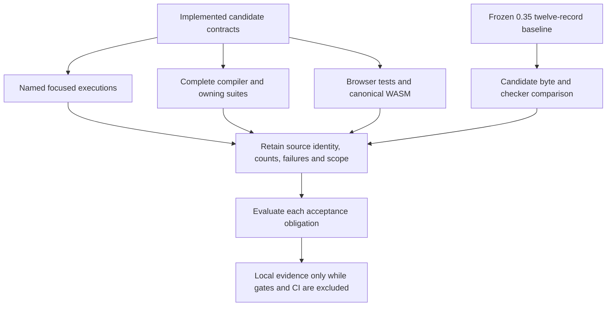

# Issue #104 acceptance record

Issue: [#104: layout and lowering contracts](https://github.com/CellScript-Labs/CellScript/issues/104).
Contract: [layout and lowering](../../CELLSCRIPT_LAYOUT_LOWERING_CONTRACT.md).
Development branch: `0.36`; source baseline: `0.35` commit
`c31e31754ac455ea3f071d21efd1ea05af4ec378`.

Status: **technical verification of A01-A15 is complete within the declared
scope**. At the final comment-fixed executable source, the complete native
compiler library passed **1,193 tests**, and the release-profile invocation of
all eleven integration targets passed **405 tests**, both with zero failures
and zero ignored. The fourth canonical WASM build and size budget also passed.
Earlier failures and the deliberately interrupted duplicate debug invocation
remain in this record.

This technical result is not a passing gate, hosted CI, merge/integration
readiness under the gate policy, release or deployment acceptance. Two early
signed-commit attempts timed out in GPG pinentry; subsequent GPG signing
succeeded. Both source commits below have valid signatures (`git %G? = G`),
and unsigned fallback was never used. Consult
[issue #104](https://github.com/CellScript-Labs/CellScript/issues/104) for the
published branch head and issue-closure record. Tests alone do not establish
those Git or issue lifecycle outcomes.

## Signed source commits

| Source owner | Commit | Signature result |
| --- | --- | --- |
| Independent checker machine effects and proof clobbers | [7c203840c56e80110ae6d05b2f79b82806ec7633](https://github.com/CellScript-Labs/CellScript/commit/7c203840c56e80110ae6d05b2f79b82806ec7633) | `G`: good GPG signature |
| Backend layout plans and standalone assembly fixes | [24f4e02d0a431d0aa9c72dcbd5cab982900656bb](https://github.com/CellScript-Labs/CellScript/commit/24f4e02d0a431d0aa9c72dcbd5cab982900656bb) | `G`: good GPG signature |

The frozen `4c15...` source manifest and its 751-input audit correspond to the
final executable source at `24f4e02d0a431d0aa9c72dcbd5cab982900656bb` (including the preceding checker
commit). Evidence-only documentation commits do not change those tested
compiler/checker inputs. The manifest hash remains an input-snapshot identity,
separate from either Git commit hash.

## Source identity and verification phases

Retained source manifests identify the distinct verification snapshots:

| Snapshot | SHA-256 identity | Applicable verification |
| --- | --- | --- |
| Pre-style candidate with FixedAggregate/output-compatibility changes | `bc3c7d14e1ac7a78da711cc419e27b4229bd18ac8cd10f09eb7fa3da475bd1c9` | The combined compiler/eleven-owning-suite command was built against this snapshot: library 1,192 passed / 1 failed; later integration targets did not execute. |
| Subsequent style-only source | `58c90e320f48254939e29dae7182c4aa735488a1b3a62b3f86908cdde6be1879` | 20 layout/storage tests, style-only compiler clippy, browser checks and third canonical WASM build/size receipt. This is not the later comment-fixed source. |
| Later comment-fixed source | `4c15e44a16d4aae681ded1b60981d6049fa292e6e1d199878d269f342d5b3ae3` | Complete compiler library **1,193 passed / 0 failed / 0 ignored**, standard-library 13-test, compiler clippy and fourth canonical WASM build/size receipts passed. Release integration **405 passed / 0 failed / 0 ignored**, all eleven targets, exit 0. Duplicate debug integration was intentionally interrupted after 50 passing tests; no complete debug pass is claimed. |

The intervening executable source change replaced eight equivalent modulo
alignment predicates with `is_multiple_of`. This difference is not erased by
calling all checks one unchanged snapshot. Each identity is SHA-256 of the
retained `source-manifest.json` bytes, not a Git commit ID, release tag or hash
of the compiler binary. The manifest schema is
`cellscript-issue104-wasm-source-snapshot-v1`: it records the base commit,
tracked patch identity, copied untracked paths and 751 files with path, byte
length and SHA-256. The snapshot includes documentation as well as executable
inputs; later documentation edits do not retroactively change the retained
manifest or establish a new executable verification receipt.

The local evidence root is
`/home/arthur/RustRoverProjects/CellScript-issue104-wasm-validation/target/issue104-wasm-evidence`.
The pre-style manifest is `final/source-manifest.json`; the style-only manifest
is `final-style/source-manifest.json`; the latest comment-fixed manifest is
`final-comments/source-manifest.json`. Each has a neighboring
`source-manifest.sha256`. These are retained local artifacts, not a published
release.

A retained final source audit also completed with exit 0:
`target/issue104-verification/final-source-audit.json` records
`checked_files: 751`, `drift: []` and source-manifest identity
`4c15e44a16d4aae681ded1b60981d6049fa292e6e1d199878d269f342d5b3ae3`.
Its SHA-256 is
`895cb81a25740b2b11dd55e4fb5dc603d1badf5b0aec002df793639c66a10df2`.
This is the retained executable-source audit receipt, not a claim that later
edits to this evidence document retroactively change the tested snapshot.

## Frozen 0.35 baseline and candidate compatibility

An isolated 0.35 worktree executed
`ordinary_source_layout_matches_frozen_baseline`: six ordinary programs under
default and unoptimized diagnostic settings produced twelve compiled records,
all independently accepted. No baseline case was rejected.

| Artifact | Identity and preservation rule |
| --- | --- |
| Original isolated baseline test source | SHA-256 `baed230b1b3a330262ebba723b21fc385dbf3ad44e289093cd2c9461b5c40824` |
| Current `tests/issue104_layout_compat.rs` | SHA-256 `e4b468ef6bdde07cff3f6882f80ff379b84d8594ff5e4da72be618c41e457f39`; differs only by rustfmt import ordering/line wrapping. It is not byte-for-byte identical to the original test source. |
| `tests/fixtures/layout_compatibility_baseline.json` | SHA-256 `7a02387c52e51f7414d0df3a00ac2f8eed29500a93d529c5aefb9cc156dc7e4f`; frozen expectations remain unchanged. |

The programs are `typed_cell_predicate`, `document_product_sum_relation`,
`document_cache_scalar_forwarding`, `nested_migration`, `wide_record_return`
and `scalar_cfg`. The JSON preserves the original ELF byte lengths, SHA-256
identities and checker outcomes.

A previous candidate comparison passed during implementation. The retained
`compatibility-after-style.log` now also reports one passing test against the
unchanged twelve-record expectations at the style-only source. The combined command later failed its standard-library assertion; the new
independent full-library command passed 1,193 tests; the separate release
eleven-target integration command passed 405 tests, including a fresh
twelve-record frozen comparison. The duplicate debug invocation was
interrupted and remains a separate incomplete receipt. Finite source/ELF/checker identity
is not VM execution,
a performance result or whole-language equivalence. Do not refresh frozen
expectations to conceal a candidate difference. Do not set
`CELLSCRIPT_RECORD_LAYOUT_BASELINE` for candidate acceptance: that variable
belongs only to an explicit baseline producer operation.

## Fifteen acceptance obligations

All fifteen technical obligations below are verified at their stated scope.
The matrix combines actual owner results with bounded implementation review;
it does not turn finite checks into whole-language equivalence, a general
allocator proof or universal diagnostic coverage. A12 is conditional: no new
optimization result is claimed, so it does not acquire an invented benchmark.

| ID | Obligation and implementation owner | Evidence and current disposition |
| --- | --- | --- |
| A01 | Separate semantic identity, wire encoding, executable storage, call ABI and final machine layout without a duplicate TypeId hierarchy or allocator. | **Verified (declared scope).** Contract documents and `src/codegen/layout.rs` / `layout/storage.rs` make the ownership explicit. Existing resolver/fixed-layout/scalar allocation owners remain. Implementation/ownership review completed; existing semantic and allocation owners are preserved. This is not an allocator-optimality claim. |
| A02 | Independent instruction reads/writes/control flow; unknown writes kill affected facts and x0 stays immutable. | **Verified (declared scope).** Checker-owned `machine.rs` and `machine/constants.rs`; standalone checker library: **107 passed**. Complete release `artifact_checker` owner: **270 passed**, zero failed/ignored. This consumer admission evidence remains distinct from decoder-unit coverage. |
| A03 | OP-32 clobbers and AUIPC/store/RET handling, including complete checked bundles. | **Verified (declared scope).** `tests/artifact_checker/instruction_effects.rs`: **3 focused passed**, including rebound bundle mutations; the complete release `artifact_checker` owner now reports **270 passed**, zero failed/ignored. All eleven release targets completed: **405 passed**, zero failed/ignored, exit 0. This is not a general source-equivalence or whole-CFI claim. |
| A04 | Text/rodata alignment, fixed prefix and final branch reachability agree; placement errors retain provenance. | **Verified (declared scope).** `src/codegen/assembler/layout.rs` freezes placement and promotes branches until stable. Alignment, 4,092-to-4,096 branch and native diagnostic owners passed within the latest complete compiler library: **1,193 passed**, zero failed/ignored. |
| A05 | One final plan supplies ELF bytes, symbols and machine/source-map evidence. | **Verified (declared scope).** Producer plan is integrated into assembler emission/evidence. Latest complete compiler library passed **1,193 tests**, including machine plan/emission/evidence units. Latest release frozen comparison passed (1 test / 12 ELF/checker records at `4c15...`); all eleven release integration targets passed. Selected immediate plans and fixed trampoline remain separate contracts. |
| A06 | Register/stack frontier, split spans, hidden results and scalar/wide/record/tuple/status transports. | **Verified (declared scope).** **11 transport-plan tests passed** in the earlier 20-test `58c...` filter and again in the latest complete 1,193-test library at comment-fixed source. Release VM/checker owners passed: `value_return_abi` **12**, `stack_layout` **5**, `structured_committed_types` **7**, plus `verifier_failure` **11** for failure/status propagation. |
| A07 | Physical scalar reuse and addressed exclusions; wide buffers, cache, scratch and outgoing arguments remain disjoint. | **Verified (declared scope).** **9 storage-plan tests passed** in the earlier `58c...` filter and again in the latest complete library, with legal whole-slot reuse, explicit buffer aliases, zero widths and protected overlap rejection. Release `cell_data_views` **9 passed** and `artifact_checker` **270 passed** supply view/forwarding/mutation evidence; release `stack_layout` **5 passed** and `selection_bundle` **18 passed**, including real frame/selection execution. |
| A08 | Preserve wire codecs, unaligned/empty/wide fields and nominal owner distinctions without host `size_of` schemas. | **Verified (declared scope).** Existing fixed-layout/nested/view/value-return owners retained. Strict generated TypeScript/Node/native-byte parity: **1 passed** at its retained phase. Latest release `bounded_nested` **33 passed**, `cell_data_views` **9 passed**, `entry_witness_abi` **26 passed** and `artifact_checker` **270 passed**. Release `value_return_abi` **12 passed**, including fixed/empty/wide results. Counts do not enumerate every inner VM/mutation input. |
| A09 | Correct generated unsigned math and syscall buffer/status semantics, or explicitly retire unsupported behavior. | **Verified (declared scope).** Comment-fixed standard-library owner: **13 passed**, including the **5 generated tests / 260 VM math calls**, actual CKB buffers/partial loads, checked scalar errors, rejection of every advertised generated collection symbol and the unchanged legacy comment assertion. Earlier `isqrt(2)` failure is preserved. Latest release `ckb_std_compat`: **13 passed**, zero failed/ignored; this broader compatibility owner is now complete. All eleven release targets completed successfully; the debug interruption remains separate. |
| A10 | Emitted inventory/aliases agree; mulhu/rori/roriw covered; invalid counts, trailing operands, shifts and ISA reject. | **Verified (declared scope).** Producer form inventory/parser tests and independent instruction decoder are separate. Standalone checker **107 passed**; the compiler assembler/inventory owners passed in the latest complete **1,193-test** library. Complete release artifact-checker mutations now report **270 passed**, zero failed/ignored; the complete release invocation passed all eleven targets. `sgtu` is not newly admitted. |
| A11 | Separate byte-preserving refactors from correctness/API fixes; version actual ABI/wire/deployment changes. | **Verified (declared scope).** Frozen twelve-record expectations unchanged. Raw standalone syscall descriptors are an intentional API correction; retired generator symbols reject. No source edition/public wire schema bump is introduced. Style-only and latest `4c15...` release ordinary-source comparisons passed with unchanged twelve-record expectations. |
| A12 | Any optimization claim has separate bytes/frames/peaks/cycles/syscall/loading measurements. | **Verified (declared scope).** **No new performance result or global optimum claimed.** Branch convergence, typed plans and a finite byte-identity control are not a cost benchmark. |
| A13 | Standalone checker stays independent; browser stays metadata-only within its budget. | **Verified (declared scope).** Checker full library **107 passed**, checker all-target clippy exit 0; browser summary **32 passed** at the earlier `58c...` phase. Fourth (`final-comments`) canonical WASM build: exit 0, 1,933,786 raw bytes, **730,956 gzip bytes <= 1,536,000**, budget passed, source-manifest `4c15...`. All four retained attempts produced the same WASM hash at their distinct source snapshots. Dependency ownership and no-new-exported-plan scope remain explicit. |
| A14 | Ordinary helpers, typed/nested views, wide parameters and record results remain actual compatibility controls. | **Verified (declared scope).** Six baseline sources × two diagnostic settings accepted. Latest `4c15...` release frozen comparison passed (1 test / 12 records); `bounded_nested` **33 passed**, `cell_data_views` **9 passed** and `artifact_checker` **270 passed**. Release `stack_layout` **5 passed**, `structured_committed_types` **7 passed**, `value_return_abi` **12 passed** and `selection_bundle` **18 passed**. No new syntax is claimed. |
| A15 | Affected diagnostics retain source/generated provenance, failed boundary and responsible consumer. | **Verified (declared scope).** Latest 1,193-test library passed transport/storage and native assembler-provenance units; CLI `cellc_check_json_reports_multiple_ir_diagnostics`: **1 passed**. Native assembler errors retain generated line/text/section/op_index and no claimed CellScript source location (default/zero raw span; CLI source range null). Metadata-only LSP/browser paths do not execute the assembler: they retain their existing source diagnostics and must not fabricate native generated provenance. Broader native consumer outcomes remain scoped to their actual receipts. |

## Retained focused receipts

Logs below are local retained artifacts under
`target/issue104-verification/`; they are not checked-in release reports.
Counts refer to executed Rust tests unless explicitly identified as inner VM
calls. Timing is the test runner's elapsed duration, not a frozen application
latency budget.

| Log | Observed terminal result | Scope / source qualification |
| --- | --- | --- |
| `generated-stdlib-final.log` | **5 passed**, 0 failed; 0.80 s | Corrected standalone generator snapshot; math test contains 260 VM invocations. Does not execute the ordinary DSL runtime through these symbols. |
| `stdlib-after-style.log` | **12 passed, 1 failed**; 1.30 s | Earlier style-only owner: five generated execution tests passed, original load-script comment assertion failed. Preserve this failed receipt. |
| `stdlib-comments-rechecked.log` | **13 passed**, 0 failed; 1.59 s | Later comment-fixed owner: retains the original assertion and executes the five generated tests, including 260 VM math calls. |
| `compiler-clippy-rechecked.log` | **Exit 0**; 23.48 s | All-target compiler clippy after the complete raw/checked comment-contract correction. |
| `compatibility-after-style.log` | **1 passed**, 0 failed; 3.88 s | Frozen twelve-record ELF/checker comparison at the style-only source, without refreshing expected bytes or admission. |
| `checker-instruction-effects-final.log` | **3 passed**, 0 failed; 0.51 s | Full rebound bundle mutations for OP-32 arguments, reserved/partial-call admission and store-immediate/AUIPC handling. |
| `layout-after-style.log` | **20 passed**, 0 failed; 0.00 s | 11 call/return classifications plus 9 storage tests at the earlier `58c...` phase, before the final pure-comment restoration. Structural tests do not replace actual VM call/view execution. |
| `fixed-aggregate-regression.log` | **1 passed**, 0 failed; 0.01 s | Original fixed-array helper regression passes after restoring distinct FixedAggregate classification/descriptions. Its existing assertion was not weakened. |
| `standalone-checker-final.log` | **107 passed**, 0 failed; 0.10 s | Complete standalone-checker library owner. Not the complete compiler mutation integration binary. |
| `cli-sdk-parity-final.log` | **1 passed**, 0 failed; 1.37 s | `CELLSCRIPT_REQUIRE_TYPESCRIPT=1`; log explicitly confirms strict TypeScript and generated Node/native-byte parity actually executed. |
| `cli-sdk-parity-after-style.log` | **1 passed**, 0 failed; 1.24 s | Style-only source rerun also explicitly reports strict TypeScript/generated Node/native-byte parity execution. |
| `cli-diagnostics-final.log` | **1 passed**, 0 failed; 0.04 s | Exact existing multiple-IR-diagnostic JSON test, not all CLI/LSP diagnostics. |
| `wasm-summary-final.log` | **32 passed**, 0 failed; 0.43 s | Earlier `58c...` phase: bounded browser summary and omission of native proof/provenance, before final pure-comment restoration. Not ELF execution or canonical packaging. |
| `compiler-clippy-after-style.log` | Exit 0 | Compiler all-target clippy after equivalent alignment-predicate style changes. |
| `checker-clippy-final.log` | Exit 0 | Standalone checker all-target clippy. |
| Third canonical `final-style` WASM run | **Exit 0; budget passed** | Earlier style-only source, actual pinned Docker Linux/amd64 original-script build. Raw/gzip sizes and hashes retained below; does not certify the later comment-fixed source. |
| Fourth canonical `final-comments` WASM run | **Exit 0; budget passed** | Latest comment-fixed source-manifest `4c15...`; pinned canonical Docker build, unchanged inputs during build and distinct retained report/hash below. |
| `compiler-owning-suites-final.log` | **1,192 passed, 1 failed**; 530.89 s | Combined command stopped at the library comment assertion; no pass is assigned to its unexecuted integration targets. |
| `compiler-library-rechecked.log` | **1,193 passed, 0 failed, 0 ignored**, exit 0; 531.76 s | Independent complete library at the latest comment-fixed executable source. Its `.rs` inputs match the fourth canonical `final-comments` manifest; includes the 20 layout/storage and 13 standard-library tests. Does not supply a result for the separate integration targets. |
| `compiler-integration-final.log` | **Interrupted**, Cargo exit 101 after SIGTERM 15 | At frozen `4c15...`: 50 tests completed with `ok` in the first `artifact_checker` target; no assertion failure recorded. That 270-test owner did not finish; downstream ten targets did not run. No complete debug pass. |
| `compiler-integration-release.log` | **405 passed, 0 failed, 0 ignored; exit 0** | All eleven integration targets at frozen `4c15...`; optimized host build, `CARGO_BUILD_JOBS=2`. Per-target durations are below. Host compilation took 12m55s separately; this is not test duration. |

### Closed log identities

The following closed local logs include passing receipts, retained failures and
intermediate compilation failures. A hash identifies the actual log; it does
not change the outcome. Both integration logs are now closed and included:
the release log records a complete pass; the duplicate debug log records its
SIGTERM interruption and partial completion rather than inheriting that pass.

| Log under `target/issue104-verification/` | SHA-256 |
| --- | --- |
| `checker-clippy-final.log` | `acbb57ca63685ce529a622be59b03047fe4aa7d5acf7a209d2617fa068722d5f` |
| `checker-instruction-effects-final.log` | `dfe8620cba4f36ff3ebe03eb08ba5ea43073eaeaedd21d8c5ad2f38758452d0d` |
| `checker-instruction-effects.log` | `d38f33a72b5d55d6fc79bcf2f7c51e97a8e1a3d68faad95730fdb6008e5e379d` |
| `cli-diagnostics-final.log` | `ee82e340e0721d5705f78e2383d5dc7e53e1593f64d1733139fbe38f90359202` |
| `cli-sdk-parity-after-style.log` | `a0b73eef0a232c6064772598dd8dc40a163671939f4bd8a2304c6dc427f047bc` |
| `cli-sdk-parity-final.log` | `79b1f6e72b270670618859feba55112de538741302cb74f4a6c04c69f96fcdfe` |
| `compatibility-after-style.log` | `ca772ef66d40950f1968aac262417b5c6a364907c89ab57b197fc3cff8b9d7d2` |
| `compiler-clippy-after-style.log` | `93a3bddbf848688441a1e901e58ad761c047e5e44a1ffc73d12def034a0144d4` |
| `compiler-clippy-comments-final.log` | `2da072b4eb10e5f34808ca4c390af95f8ec914a6fd18c401dd0c4e9168dac969` |
| `compiler-clippy-final.log` | `49698e05743d556352f60be61cc4f8d9613306c96f63eb337cc5a4c668f8183e` |
| `compiler-clippy-rechecked.log` | `f16a9e3caba51d900adc8314bb97b3d7b059d636f58dc694501dc7157caf895e` |
| `compiler-integration-final.log` | `50d60a5b94be71e2ae4d430648b368ebe2d9d25f1d0c4724212fa2b1d08f5f00` |
| `compiler-integration-release.log` | `d59f5cd7446657565d87febdf6342c7aedbc8950a6ae7e3c36379fa5bc04e311` |
| `compiler-library-rechecked.log` | `2482b8c544bd368f7fc8ac8f17252f9a6de4075af3d55a89f0ad79897e8abfa3` |
| `compiler-owning-suites-final.log` | `ae7db950d76528eb148a2103342808552bb812d6033f95cdce5cdcea82f2f770` |
| `compiler-owning-suites.log` | `d9fbd3b4850e7d67b14ddf9892dec35f9f7cb1bff3a8f96385ba13fcd89b81ac` |
| `fixed-aggregate-regression.log` | `f1ff93f5abc34fefd9d4d9d61d7550f67a44d35dd30589eaa63c179e59e6e9d0` |
| `generated-stdlib-final.log` | `cc78f00e38ae20315b57103d41b11b7e1a3a7b799b49d7b24b5ae0864c9835ea` |
| `generated-stdlib-fixed.log` | `7897c47c3abcc311decf2b94473925fac40089fa28dab3c5018be45771435248` |
| `generated-stdlib.log` | `9f22588178aa46ced7693c38cd2b86e3e57c2dd1beb3e273e8ac815ab4b8163a` |
| `layout-after-style.log` | `f52142fac35f25048539c2b423992d4faeac3b7890ad0bbf2bf7df96fd22bb32` |
| `layout.log` | `f0963b0fdf0d227d727e08f13242fc01d3df03a2369de7a5b43314be029f6f3b` |
| `standalone-checker-final.log` | `5fe17a463d88bfeebbe7df2c3dbc1bc07b436b98365c11cdc6272fef3c0fdcc0` |
| `stdlib-after-style.log` | `ba8269f13e3902a4eaaaafd62ea17c086a13bcd0f02885dfdb80cec495f4cd70` |
| `stdlib-comments-final.log` | `5ab83e044df9ffe00b65faef3f7d4be3965cb6214a7fab10477a8df2b9e009bf` |
| `stdlib-comments-rechecked.log` | `c0a5f889aea10fb55e77832e86e458ca65fd90d68303c12569b9e0e9353198f5` |
| `wasm-summary-final.log` | `d16ffb990868a733bd3fea10ecca085b5ec6be90b4eb6a991ba528f111babee4` |

A filename containing “final” is not a source-continuity proof.

### Third canonical WASM receipt: final-style snapshot

The local evidence root stated above contains
`final-style/validation-report.json`, with SHA-256
`245e7e981f55eda0a5766c91b4e667ae5ebf20e53fba9d76660b4defe9afbbfc`.
It records exit 0, unchanged build inputs during the run, no executable-source
drift at validation time, and source-manifest identity
`58c90e320f48254939e29dae7182c4aa735488a1b3a62b3f86908cdde6be1879`.
Later documentation edits are not a claim that every working-tree byte still
matches that earlier snapshot.

The actual invocation was:

```sh
CELLSCRIPT_WASM_DOCKER_NETWORK=host website/scripts/build-wasm.sh
```

The original script selected the canonical container. The retained container
identity is
`cellscript-wasm-builder:rust-1.97.1-wasm-bindgen-0.2.121-binaryen-131`, image
`sha256:2efcbb788266f0b6809dbfdb4680f92fb83a53a8d8b9628ae661a51515bb1cc0`,
with actual Linux x86_64 tooling: Rust/Cargo 1.97.1, wasm-pack 0.13.1,
wasm-bindgen 0.2.121 and wasm-opt 131. The root host target was not substituted
for this canonical build.

| Artifact relative to the WASM validation worktree | Bytes | SHA-256 |
| --- | --- | --- |
| `website/public/wasm/cellscript_wasm_bg.wasm` | 1,933,786 | `6c1fed060de8dc7f91fc88c29d11c6513eec2841e77615aefaa822027996ce57` |
| `target/issue104-wasm-evidence/final-style/cellscript_wasm_bg.wasm.gz` | 730,956 | `52c0355bad879ce1e23fdc75d947dcb52c89866ccbca0ca23f7de1c950325e23` |
| `website/public/wasm/cellscript_wasm.js` | 11,048 | `3ba0f71478dbf6077bbc07db3a662bf46ebc7c99bd4676db5bd6f510cf53c91a` |
| `website/public/wasm/cellscript_wasm.d.ts` | 3,793 | `2ec1da9807fb52d126300fe189b88d7c46133e82c6ff2521b2199cf595d3ab30` |
| `website/public/wasm/cellscript_wasm_bg.wasm.d.ts` | 869 | `6e6a4210ac1542ba492daba14cf305ddc49df74335bbb013671e9aa315b7d84d` |
| `target/issue104-wasm-evidence/final-style/canonical-build.log` | 4,275 | `84206a4a2fe2127531fbbe13bbd4fd1b6122ce3503886328d1e35ad135199f72` |
| `target/issue104-wasm-evidence/final-style/canonical-tools.txt` | 206 | `47ce471241c783498c72dcee5c3c23c82b678dab3153cde91405da618fadde9a` |
| `target/issue104-wasm-evidence/final-style/canonical-container.txt` | 161 | `91b18627c5c983ace5996889dfadd62b8c494f1d53826c26434e3dc78f643fcc` |

The measured gzip size is 730,956 bytes against a 1,536,000-byte ceiling,
leaving 805,044 bytes. This third report records identical WASM hashes across
the first three retained attempts; that equality does not merge their different
source snapshots or independently certify the later comment-fixed source.
The fourth run has its own receipt below. This third receipt proves only its
measured canonical build/size boundary,
not browser runtime execution, ELF generation, gates, publication or production
acceptance.

### Fourth canonical WASM receipt: latest comment-fixed source

The latest retained local receipt is
`final-comments/validation-report.json` under the evidence root above. Its
SHA-256 is
`bf2477487c06e96930ea622f2276a0cd5b68cc6643fd7911b066c2e5ca60fd67`.
`final-comments/source-manifest.json` retains 751 inputs and has SHA-256
`4c15e44a16d4aae681ded1b60981d6049fa292e6e1d199878d269f342d5b3ae3`.
Comparing the third and fourth retained manifests identifies exactly two changed
files: `src/stdlib/mod.rs` and `src/stdlib/generated_tests.rs`. They restore
comment display prefixes and explicit private syscall-number/name pairs,
including the cfg(test) call site; they do not change the ordinary source
syntax or the standalone raw syscall register contract.

The fourth run used the same original command and pinned canonical
Linux/amd64 container/tool identities stated above. Its report records exit 0,
unchanged snapshot inputs throughout the build, no executable-source drift at
validation time, and a passing size budget:

| Fourth-attempt artifact | Bytes | SHA-256 |
| --- | --- | --- |
| `website/public/wasm/cellscript_wasm_bg.wasm` | 1,933,786 | `6c1fed060de8dc7f91fc88c29d11c6513eec2841e77615aefaa822027996ce57` |
| `final-comments/cellscript_wasm_bg.wasm.gz` under the evidence root | 730,956 | `aa8c67d66f77b1206924bb7f761deabbaae5b277da0c2d11d39294f66c18e3d2` |
| `final-comments/canonical-build.log` | 4,275 | `ad02171a0f0a27a42fd87539937d171c81d7a2b992327518e92f984fd840a20b` |
| `final-comments/canonical-tools.txt` | 206 | `47ce471241c783498c72dcee5c3c23c82b678dab3153cde91405da618fadde9a` |
| `final-comments/canonical-container.txt` | 161 | `91b18627c5c983ace5996889dfadd62b8c494f1d53826c26434e3dc78f643fcc` |

The actual gzip measurement is again **730,956 <= 1,536,000 bytes**; raw WASM
SHA-256 is identical across all four retained attempts. The compressed files
retain their own recorded hashes rather than borrowing an earlier attempt's
identity. The 20 layout/storage tests and 32 browser-summary tests remain
attributed to the earlier `58c...` phase. The 20 layout/storage tests also
passed again inside the latest 1,193-test native library. The independent
release integration invocation passed all eleven targets (405 tests); the
duplicate debug invocation was interrupted and is not a passing full profile. This fourth canonical
build/size pass does not close every acceptance criterion or establish browser
runtime execution, gates/CI, release or deployment acceptance.

## Failure history and corrections

| Retained log | Actual result | Correction and remaining evidence boundary |
| --- | --- | --- |
| `generated-stdlib.log` | **4 passed, 1 failed**; 0.31 s. Real `isqrt(2)` returned 2. | Use overflow-safe `(n >> 1) + (n & 1)` for the Newton initial estimate. The later five-test receipt passes; this failed run remains failed. |
| `generated-stdlib-fixed.log` / `checker-instruction-effects.log` | Intermediate compilation failed during concurrent source migration; no test execution receipt. | Do not count compilation failure or a zero/unstarted test set as passing behavior. Later named receipts supersede only their tested scope. |
| `layout.log` | Earlier **18 passed** layout/storage tests. | Historical structural receipt, not the final 20-test source containing the later return guards. |
| `compiler-owning-suites.log` | **1,191 passed, 2 failed**, 502.93 s; library exit failure. | Failures were `stdlib::tests::test_generate_ckb_assembly_uses_ckb_load_script_syscall` and `tests::compile_unrolls_fixed_param_array_foreach_with_pointer_abi`. Downstream owning suites did not gain a pass from this command. |
| `stdlib-after-style.log` | **12 passed, 1 failed**, 1.30 s. The load-script comment assertion failed. | Preserve this terminal failure; later successful receipts do not retroactively pass it. |
| `compiler-owning-suites-final.log` | **1,192 passed, 1 failed**, 530.89 s. The same comment-prefix assertion failed. | The combined invocation stopped before its eleven integration targets. A second full-library and separate integration invocation were started after the complete fix; neither is inferred green from the focused owner. |
| `stdlib-comments-final.log` / `compiler-clippy-comments-final.log` | Compilation failed with **E0308** before a test receipt. | The checked scalar helper changed to a `(syscall_number, comment_name)` pair; one cfg(test) call site initially still supplied a number alone. The call site was corrected before the later 13-test/clippy rechecks. |
| First compiler all-target clippy run | Failed on six style diagnostics. | Equivalent alignment predicates were normalized; later all-target clippy passed. This is not a behavioral test receipt. |
| `compiler-integration-final.log` | **Interrupted by SIGTERM 15**, Cargo exit 101; 50 completed `ok` tests, no assertion failure recorded. | Stopped only after the identical eleven-target release collection completed successfully. The active artifact-checker test and downstream ten targets did not finish in debug; no complete debug result is claimed. |

The complete-library failures exposed emitted-text compatibility assertions:
the raw syscall generator had changed established comments, and the call
classifier no longer retained the fixed-aggregate description. The correction
introduced an explicit `FixedAggregate` classification without removing the
original assertions. Its focused regression passed. The first comment repair
was incomplete: raw display names still included `syscall_`, and checked
by-field helpers were not entries in the raw table. The full correction strips
the raw display prefix and supplies explicit `(syscall_number, comment_name)`
pairs to checked scalar helpers. After the cfg(test) call-site correction,
the 13-test standard-library owner and compiler all-target clippy passed.
The fourth canonical WASM build/size receipt now passes at its separately
identified source. The independent latest full library now passes all
1,193 tests, and the release integration invocation passes all eleven targets
(405 tests). The deliberately interrupted debug invocation retains a separate
partial receipt.



The diagram has several independent evidence paths. A codec parity test does
not prove machine execution; VM execution does not prove final distributable
packaging; the presence of a source hash does not pass a test. Acceptance needs
the results relevant to each row, with the source differences recorded.

## Exact command owners and outstanding final fields

The retained complete owning command is:

```sh
cargo test --locked -p cellscript --lib --test artifact_checker --test bounded_nested --test cell_data_views --test entry_witness_abi --test issue104_layout_compat --test selection_bundle --test stack_layout --test structured_committed_types --test value_return_abi --test verifier_failure --test ckb_std_compat -- --test-threads=1
```

That combined command invoked the library plus eleven integration test
binaries, but terminated at the library failure. It did not execute those
integration binaries. The comment-fixed verification now uses an independent
full-library command (`compiler-library-rechecked.log`) and a separate
eleven-target integration command (`compiler-integration-final.log`). Their
independent terminal results are retained below; listing an intended inventory
or observing a target start alone is not a pass.

The independent full-library command has now completed with exit 0:

```sh
cargo test --locked -p cellscript --lib -- --test-threads=1
```

Its retained log is `compiler-library-rechecked.log`: **1,193 passed, zero
failed, zero ignored**, 531.76 seconds, SHA-256
`2482b8c544bd368f7fc8ac8f17252f9a6de4075af3d55a89f0ad79897e8abfa3`.
The binary was built from the final comment-prefix/private-tuple/cfg(test)
source; its Rust inputs match `final-comments/source-manifest.json`
(`4c15...`). This closes the library execution portion, including current
layout/storage/assembler/standard-library unit owners. It does not establish
the eleven integration targets' outcomes or a passing gate.

### Debug and release integration profiles

Both integration invocations keep the final comment-fixed `4c15...` Rust
inputs, fixtures, eleven test-target identities and test assertions unchanged. They
are distinct host-build profiles with distinct logs and terminal outcomes.
The release run was added while the long-running debug invocation was still
inside its first target: individual Rust tests contain type/bound/mutation
matrices, so a started target or a partial list of passing tests is not the
completed matrix result.

The release invocation is:

```sh
CARGO_BUILD_JOBS=2 cargo test --locked --release -p cellscript --test artifact_checker --test bounded_nested --test cell_data_views --test entry_witness_abi --test issue104_layout_compat --test selection_bundle --test stack_layout --test structured_committed_types --test value_return_abi --test verifier_failure --test ckb_std_compat -- --test-threads=1
```

No test subset, fixture, assertion or admitted profile is removed for this
invocation. It additionally exercises the implementation in an optimized host
build; normal test assertions remain active. This is not an assertion that
debug and release native binaries are identical, a performance benchmark or
an authorization to weaken fail-closed checks.

| Host profile | Retained log | Disposition at this update |
| --- | --- | --- |
| Debug | `compiler-integration-final.log` | Interrupted after 50 completed `ok` tests in the first target; Cargo exit 101 from SIGTERM 15. No complete-target or complete-profile pass. |
| Release | `compiler-integration-release.log` | Complete: all eleven targets, **405 passed, 0 failed, 0 ignored**, exit 0. |

All release target summaries are present in the closed log at the unchanged
`4c15...` executable source:

| Completed release owner | Passed | Failed | Ignored | Test-runner elapsed |
| --- | --- | --- | --- | --- |
| `artifact_checker` | 270 | 0 | 0 | 511.63 s |
| `bounded_nested` | 33 | 0 | 0 | 5.57 s |
| `cell_data_views` | 9 | 0 | 0 | 0.91 s |
| `ckb_std_compat` | 13 | 0 | 0 | 0.00 s |
| `entry_witness_abi` | 26 | 0 | 0 | 0.57 s |
| `issue104_layout_compat` | 1 (12 frozen ELF/checker records) | 0 | 0 | 0.44 s |
| `selection_bundle` | 18 | 0 | 0 | 162.61 s |
| `stack_layout` | 5 | 0 | 0 | 0.43 s |
| `structured_committed_types` | 7 | 0 | 0 | 0.35 s |
| `value_return_abi` | 12 | 0 | 0 | 0.84 s |
| `verifier_failure` | 11 | 0 | 0 | 0.76 s |
| **Total executed Rust tests** | **405** | **0** | **0** | Per-target test durations above; compilation excluded |

The release command completed with exit 0. Counts are executed Rust tests;
many contain type/bound/mutation matrices or actual VM cases whose inner
population is not summed here. Recorded 0.00 seconds is the runner's displayed
precision, not a zero-cost claim. The build step's **12m55s** is host
compilation time, separate from every test duration above. No throughput or
optimization improvement is inferred.

The release log's SHA-256 is
`d59f5cd7446657565d87febdf6342c7aedbc8950a6ae7e3c36379fa5bc04e311`.
After this complete pass, the duplicate debug process was stopped with
SIGTERM 15; Cargo returned 101. Its closed log contains exactly **50**
completed `test ... ok` lines and no `FAILED` assertion line. Only
`artifact_checker` had started (270 tests announced). The next active test was
`allocated_scalars::scalar_definitions_bind_arithmetic_u32_diagnostic`; it has
no completion result. Thus 220 of that owner's announced tests have no
completed passing result, including the interrupted active test, and the ten
subsequent targets never ran in this debug invocation.

The debug log's SHA-256 is
`50d60a5b94be71e2ae4d430648b368ebe2d9d25f1d0c4724212fa2b1d08f5f00`.
This is an intentional interrupted duplicate receipt, not an assertion failure
and not a complete debug pass. The release result belongs only to its own
fully executed profile. Both use the same frozen source/fixtures/test
collection; neither is a gate or hosted CI.

The existing focused owners include:

```sh
cargo test --locked -p cellscript --lib stdlib::generated_tests -- --test-threads=1
cargo test --locked -p cellscript --test issue104_layout_compat -- --test-threads=1
cargo test --locked -p cellscript --test ckb_std_compat generated_stdlib_syscall_surface_uses_central_ckb_abi_table -- --nocapture
cargo test --locked -p cellscript --test value_return_abi -- --test-threads=1
cargo test --locked -p cellscript --test stack_layout -- --test-threads=1
cargo test --locked -p cellscript --test cell_data_views data_predicates_compose_through_typed_read_only_helpers -- --nocapture
```

This owner list is not an assertion that every listed focused invocation ran
separately. Reuse complete-suite evidence when the owner already executed;
do not rerun a subset merely to manufacture another receipt.

The technical A01-A15 evidence above is complete at the declared scope.
The two early pinentry timeouts remain historical workflow failures (the
second exited 128 and created no commit object). Subsequent successful GPG
signing resolved that interruption: both source commits above verify as `G`,
`commit.gpgsign=true` was respected, and no unsigned commit was used. Keep the
earlier `58c...` receipts and final `4c15...` input identity distinct from the
Git commit identities. The published branch head and issue closure are tracked
in [issue #104](https://github.com/CellScript-Labs/CellScript/issues/104),
rather than inferred from these test results.

## Gates, publication and deployment

| Boundary | Disposition |
| --- | --- |
| commit/dev/backend/ci/release/release-quick gates | **Not run**, by maintainer instruction. No historical pass is inherited. |
| Hosted CI | **Not run** for this work. Focused local checks are not hosted CI. |
| Merge/integration readiness | Technical A01-A15 verification is complete in the stated scope; matching gates were not run, so gate-policy merge/integration readiness is not claimed. |
| New release/distribution | Not created by a branch name, source changes or this record. |
| Public deployment / independent security audit | Not claimed. |

The normal [gate policy](../../CELLSCRIPT_GATE_POLICY.md) remains unchanged.
Excluding gates is not a passing result and does not authorize publication or
deployment.
