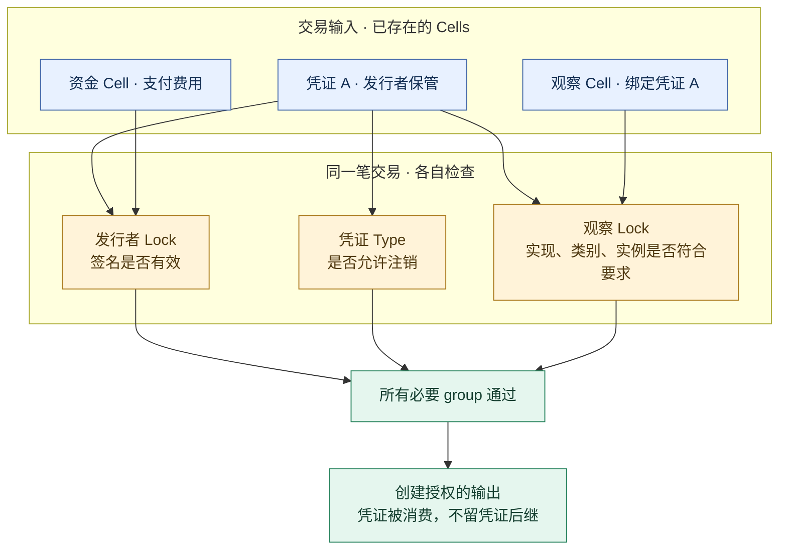
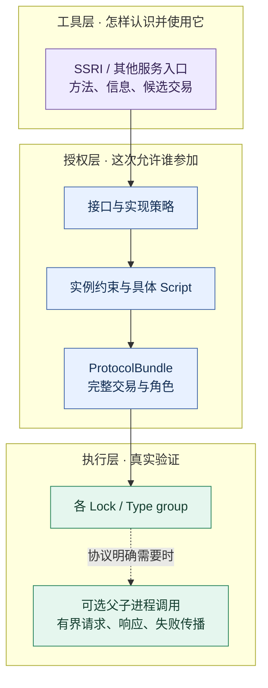
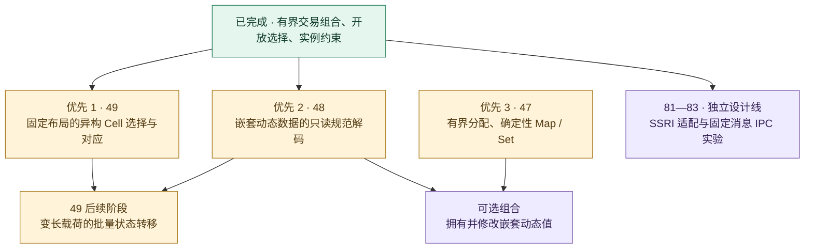

# 几个 CKB 合约怎样一起办成一件事？CellScript 的现状、SSRI / IPC 的选择与下一步

> Nervos Talk 中文帖子草稿，尚未发到论坛。事实核验：2026-10-18。
> 文中的新能力来自 CellScript **0.32 开发分支**；已发布的 0.31 编译器和浏览器 Playground 不应被当作这些新能力的运行环境。文末列出了代码、证据和待评审设计。

假设你有一份链上凭证。发行机构负责保证它是真的，你的应用负责判断它是不是自己接受的类别，持有人负责授权使用。现在你希望一笔交易同时注销凭证、解除依赖它的一个 Lock。

这件事听起来只需要“调用另一个合约”，实际要回答的问题不少：凭证是哪一份？谁发行的？应用接受的是哪种实现？谁能花掉它？如果凭证合约拒绝，应用能不能仍然通过？

我们最近把 CellScript 在这方面的一段基础工作收了口，也重新梳理了 CKcon 期间讨论的 SSRI 和 IPC。本文想把已经能做的、仍然缺的、值得一起讨论的讲清楚。欢迎熟悉 CKB、但还没有使用过 CellScript 的朋友参与；后面的设计 issues 不要求先读懂编译器源码。

## 先说 CKB 上“几个合约一起工作”是什么

CKB 交易消费已有 Cell，创建新 Cell。Lock 管花费授权，Type 管相应状态规则。多个合约可以检查同一笔交易的不同部分，最终所有必要的 Script group 都要通过。

例如凭证 Type 检查注销规则，发行者 Lock 检查签名，观察 Lock 检查这份凭证是不是被允许的具体实例。交易构造者把这些要求组织成同一笔交易。



这张图表示普通交易层面的协作。另一个机制是父 Script 明确启动子程序，传数据，让子程序做计算或验证。后者才涉及 spawn、pipe、read/write 和 wait 等进程机制。子程序在父方上下文中运行，不会因为加载了某合约的代码，就自动变成那个合约自身的 Type group。

还要分清“读到了”和“验证通过”：读取凭证 Cell 不会自动获得它的花费权；把 ELF 放进 CellDep 也不等于运行了它。这些边界同时适用于原生 Rust 和 CellScript。

## CellScript 已经做了哪几层

CellScript 是编译成 CKB RISC-V ELF 的语言。它尝试让合约作者把类型、角色和约束写清楚，并生成可检查的执行产物及配套 builder。独立检查器检查代码产物和说明之间的有界契约；协议自己的业务规则仍然要由作者定义、测试和审核。

可以把目前的组织能力看成四层：

| 层 | 对开发者意味着什么 | 对应已关闭 issue |
|---|---|---|
| 组织一笔多合约交易 | 独立合约的输入输出、witness 和共享读取不会相互冲突 | #9、#10 |
| 认出确切的合作对象 | 绑定接口、代码和部署身份 | #11 |
| 在允许范围内选择实现 | 不必永远只认一个写死实现，但选择必须符合授权策略和接口要求 | #28、#29 |
| 允许不同配置的实例 | 同一份代码可以有不同 args；按约束允许这些实例，同时绑定本次实际选择 | #80 |

负责第一层的东西叫 **ProtocolBundle**。名字听起来复杂，它的工作可以理解为：将几个独立编译的合约参加同一笔交易时的身份、位置和责任整理成一份可检查的材料。它在链下工作，不代替链上验证。

#80 解决的是一个很实际的问题。两份凭证可以使用同一份 Type 代码，却属于不同命名空间、类别或序号。只看代码 hash 不够；完整 Script 中的 `args` 也是身份的一部分。

因此我们分开问两件事：**这个实现是否被允许？这个实例的配置是否被允许？** 实现可以精确固定，也可以从已授权的兼容集合选择；实例可以完全固定，也可以按有界规则约束。最后仍要绑定本次选择的完整 Script。即使 A、B 都符合策略，也不能把一笔明确选择 A 的交易换成 B。

这里的“兼容”也有限定：接口兼容不会证明两个实现的全部业务行为相同，更不会证明某个金融公式正确。

## 用已经执行过的凭证例子，走完一遍

这个例子不是假想的新 API。仓库已有[凭证 Type](https://github.com/CellScript-Labs/CellScript/blob/602795b3f8a095860eeb544518778495a7e55976/tests/fixtures/instance_policy/document.cell.in)、[观察 Lock](https://github.com/CellScript-Labs/CellScript/blob/602795b3f8a095860eeb544518778495a7e55976/tests/fixtures/instance_policy/document_observer.cell.in)和[完整测试驱动](https://github.com/CellScript-Labs/CellScript/blob/602795b3f8a095860eeb544518778495a7e55976/tests/support/instance_document.rs)。

凭证的 args 是 32 字节：16 字节命名空间、8 字节类别、8 字节序号。data 是这 32 字节加一个完整的 32 字节文件摘要。发行者的 Lock 身份固定在这个示例的实现中。

观察者只接受指定命名空间、类别 1–5、非零序号，并且绑定这次选中的具体凭证。这个序号由发行者分配，不是这里额外提供了全局 NFT 唯一性机制。

具体过程如下：

1. **分别编译两个包。** 凭证 Type 和观察 Lock 各自生成 ELF、metadata、lowering record、source map。最后三个文件用于说明和检查编译产物，不是新的链上共识规则。
2. **冻结允许的实现和实例策略。** 检查目标接口与代码来源，再指定命名空间、类别、序号的约束。不能只拿对方自报的接口名当授权。
3. **真正签发凭证。** 测试先只有普通资金 Cell，再通过带真实签名的交易创建凭证和观察 Cell。凭证不是直接塞入测试环境的“可信初始状态”。
4. **准备注销交易。** 放入实际凭证输入、观察输入、代码依赖和 witness；明确哪些角色读取同一个位置，谁负责验证生命周期。
5. **准入并冻结交易字节。** 检查实现、具体实例、输入快照和全部必要参与组；builder、检查报告与 adapter 要对应同一笔交易。
6. **签名并执行全部必要组。** 发行者验签、凭证注销、观察条件都成功，交易才通过。只跑观察 Lock 得到 `true` 不算完成。
7. **用失败例子检查边界。** 类别 6 可以被发行者合法签发，但观察者仍应拒绝。改最后一个摘要字节，应由凭证 Type 拒绝；把策略允许的 B 替换所选 A，应由观察 Lock 拒绝。不能拿一个无关的坏签名冒充这些规则被验证了。

观察 Lock 的实际源码片段如下。完整文件还包含导入和 `Document` 数据布局：

```cell
public lock verify(witness handle: InstanceScriptHandle<foreign>) -> bool {
    verification
    ckb::require_instance_script_participant_from_args(
        ckb::cell_dep(0), handle, ckb::input<Document>(1),
    )
    true
}
```

这里的 dependency 0 和 input 1 是测试交易明确安排的位置；这行调用不会替你自动寻找凭证、自动签名或调用任意远端方法。它的简洁来自已经实现的准入与运行时检查，并不表示这些工作消失了。

复现时，从匹配的 0.32 原生源码和固定 Rust 工具链运行：

```bash
cargo test --locked -p cellscript --test frozen_interface instance_document::issued_document_instances_require_real_issuer_custody_and_peer_execution -- --exact --test-threads=1
```

测试会渲染 `.cell.in` 模板并创建临时包；不要把模板直接当成完整部署项目。输出在 `target/instance-policy-evidence/document/O0` 至 `O3`，每级包含 16 个接受/拒绝交易记录，以及源码、产物、依赖和实际输入快照。冻结的执行源码为 `f55508b5`，完整哈希和重放前提见[验收索引](https://github.com/CellScript-Labs/CellScript/blob/602795b3f8a095860eeb544518778495a7e55976/docs/reports/0.32/instance-policy-acceptance/README.md)。新的源码重放会生成自己的来源身份和记录。

这些材料证明的是本地完整 Script-group VM 执行，加本地 live-Cell/capacity 检查。它们不等于该凭证应用已在公共网络部署或接受了独立人工安全审计。

仓库另有两个不同配置的池子分别执行、再一起执行的案例。但那是实例、托管和实际交易的有界验证，不能据此宣布 LP 生命周期、任意路由或完整 DeFi 已经做完。

## 原生 Rust 会怎样写

Rust 完全可以实现同样的规则，也能把重复检查整理成库。对比的重点应是**作者在哪里表达规则、哪些工作由工具生成、哪些证据还得自己补**，而不是用一个 DSL helper 与另一边整套库的行数作比较。

下面是相同观察 Lock 的 **Rust 风格职责伪代码**。函数名代表待实现或复用的应用 helper，不是 `ckb-std` 现成 API，也不是已编译、已跑 VM 的第二份验收合约：

```rust
fn verify_observer() -> Result<(), Error> {
    let config = read_and_check_current_lock_args()?;
    let selection = decode_bounded_selection_from_group_witness()?;
    let document = read_document_at_transaction_input(1)?;
    let actual_code = read_code_dependency(0)?;

    verify_implementation_membership(&config, &selection, &actual_code)?;
    verify_required_interface_and_role(&config, &selection)?;
    verify_complete_script_identity(&selection, &document.type_script)?;
    verify_instance_constraints(&config, &document.type_script.args)?;
    verify_document_layout_and_declared_input_binding(&document)?;
    Ok(())
}
// 凭证 Type 仍须独立验证发行者、摘要和注销；相关 Lock 仍须验签。
```

原生实现可用 `ckb-std` 的实际 source/index 读取与 Molecule 解码来完成这些 helper，配合 Rust SDK/CCC 构造交易。若只需固定一个 exact Script，代码还能更简单；公平比较时，CellScript 也必须选择同样的 exact 范围，不能一边做动态策略，另一边只比较常量 hash。

| 工作 | 原生 Rust 路径 | 当前 CellScript 路径 |
|---|---|---|
| 读取 Script、Cell、witness | 手写或复用读取/解码库 | 类型化视图、受限 helper 和生成代码 |
| 实现/实例准入 | 应用库显式验证策略和具体身份 | handle/policy 编译与检查链 |
| 发行、托管、注销等业务规则 | 作者编写 | 作者编写，handle 不替你决定 |
| 多合约交易构造 | SDK、协议 builder 与调用方负责 | builder、ProtocolBundle、adapter 与调用方共同负责 |
| 完整交易和失败用例 | 必须测试 | 同样必须测试 |
| 参数化通用 IPC 服务 | 可使用 Rust 宏/运行库并补协议约束 | 尚处于 #83 设计，不存在本文隐含的新语法 |

这篇文章没有给出两种实现的性能排名。后续比较必须使用相同功能、相同身份检查和失败语义，分别测量 cycles、ELF、内存、传输字节及工程维护量。

如果进一步把“检查凭证内容”拆成一个 IPC 服务，原生 Rust 可以按上游宏的现有形式声明接口。例如下面是**拟议业务接口的写法示例**，没有在本次文档工作中编译或执行：

```rust
#[ckb_script_ipc::service]
pub trait DocumentVerifier {
    fn check(
        namespace: [u8; 16],
        category: u64,
        serial: u64,
        digest: [u8; 32],
    ) -> Result<bool, u64>;
}
```

这个宏形式来自[上游用法](https://github.com/XuJiandong/ckb-script-ipc/blob/4044faee42ed844f0696841cabd6504db13e5de4/README.md)：开发者仍要实现 server、启动 child、选择依赖、处理通信，并补齐身份、请求来源和资源约束。仅传入这些参数，不会证明它们来自真实凭证 Cell。当前 CellScript 没有与这段声明对应的通用服务语法；#83 正是要讨论如何复用这类能力，以及生成器和检查器应承担哪些部分。

## 那么 SSRI 和 IPC 能补什么

SSRI 的原始全称是 **Script-Sourced Rich Information**。它让工具通过 Script 提供的方法获取信息或逻辑结果，例如了解接口、显示信息、辅助生成交易。它关注的是怎样把这些能力更紧地绑定到 Script，并给调用者共同约定。[原始设计](https://talk.nervos.org/t/en-cn-script-sourced-rich-information-script/8256)

`ckb-script-ipc` 则提供从 Rust trait 生成 client/server 的机制，并封装进程间请求和响应；它也提供 native host 执行入口。因此，把二者说成“SSRI 只管链下，IPC 只管链上”会遗漏实际能力。[上游实现](https://github.com/XuJiandong/ckb-script-ipc/tree/4044faee42ed844f0696841cabd6504db13e5de4)

在当前需求里，可以先这样划分责任：



这只是需求分层，不是已经选定“SSRI + IPC 双协议”的架构。我们要比较至少四条路线：保留现有路径；先做 SSRI 适配；以 IPC 服务为主并补发现约定；分层组合两者。如果需要自建小协议，也必须说明哪个具体约束无法复用，以及谁长期维护它。

调研还有一些容易被“直接接上”掩盖的细节：

- 所查 `ckb-ssri-std` 中有已实现的方法分发，也有入口/宏的 TODO；原设计与具体库的某些 syscall 约定存在差异。要先固定目标 server、客户端和版本，不能把不同版本拼成想象中的统一规范。[源码基线](https://github.com/ckb-devrel/ckb-ssri-std/tree/93f3a77970d5b1864e7ca0ce13e61010061237f2)
- 所查 IPC 库的默认 Channel 使用 JSON，包封装使用 VLQ，服务循环允许持续处理请求。CellScript 若采用它，需要明确消息长度、调用次数、分配预算、结束和错误规则。改成 Molecule 可以讨论，但不能改完就声称与默认客户端自然互通。
- 方法存在、响应成功、接口匹配，都不自动等于“得到花费授权”。业务条件和所有必要 Script group 仍须执行。

所以讨论“IPC 是否更先进”，最好带一个具体例子：节省了几次启动？减少了多少重复代码？哪些钱包可以直接用？最大失败成本是多少？为了兼容额外维护了什么？这些问题比一个总排名更有助于决定。

## #47、#48、#49 还没完成，它们分别卡在哪里

这三项在核验时都仍然开放，规划目标写为 0.33，没有本文承诺的完成日期。它们是通用基础扩展，不能用“已经能把两个池子放进同一交易”来代替验收。

**#49：面对不同布局、不同角色的一组 Cell，怎样完整选择并正确对应输入输出。** 比如有些 Cell 是凭证，有些是结算记录，不能只拿 witness 给出的一串 index 就相信集合完整。需要证明没有漏掉受保护项、重复使用同一个输出或把外部观察变成自己的消费权限。第一阶段先做固定布局的异构角色，之后再支持变长载荷。[Issue #49](https://github.com/CellScript-Labs/CellScript/issues/49)

**#48：怎样规范解码嵌套的动态数据。** 例如一批长短不同的消息，或者每条记录都有一段变长 payload。需要约定层数、数量、总字节、Molecule offset 和边界，拒绝越界、溢出或不规范编码。先做有界只读视图，不必等通用堆分配。[Issue #48](https://github.com/CellScript-Labs/CellScript/issues/48)

**#47：怎样在一次验证中安全地分配有界集合。** 用途包括按资产汇总、标识去重和临时索引。它要处理 Vec、确定性 Map/Set、容量耗尽、迭代顺序和所有权；这些是本次调用内的内存，不是账户式持久数据库。现有固定栈容量 Vec 并不等于这项已完成。[Issue #47](https://github.com/CellScript-Labs/CellScript/issues/47)



图中的箭头表示语义依赖，不表示 GitHub 已设置自动阻塞关系。#49 的固定布局阶段与 #48 的只读解码可以先推进；#47 不是它们统一的前置任务。只有需要拥有和修改嵌套动态值时，才要明确组合 #47 与 #48 的规则。固定消息的 IPC 小实验也不必等待三项全做完。

## 接下来怎样推进，做到什么才算完成

建议按下面的步骤组织工作，而不是先添加一个看起来很方便的新语法：

1. **固定输入问题。** #49 选一个非金融的混合角色批处理；#48 选“有界字节串列表”和“固定标识 + 变长内容的记录列表”；#47 选汇总和去重。先写明允许的形状、权限和数量上限。
2. **确定可失败的契约。** #49 明确缺失、重复、错误对应和 fee/change 排除规则；#48 明确 offset、总长度和规范编码；#47 明确分配耗尽、指针失效和确定性迭代。超限必须有可预期结果。
3. **分别完成最小可执行切片。** 让当前 Script 真正在 VM 中检查这些规则，并把相应契约纳入独立检查器。只生成 metadata 或让解析器认识类型不算完成。
4. **让构造端和链上端说同一种字节语言。** 用独立 Rust/生成 builder 的向量对照，覆盖空、单项、最大值和恶意编码；布局和版本改变要有明确迁移。
5. **在完整交易里故意破坏它。** 漏项、错实例、重复输出、一个 peer 故意拒绝都要测试。记录具体拒绝组与原因，不能只有成功案例。
6. **测最坏边界，再更新用户工具。** 最大成功和最晚失败的 cycles、stack/可观测内存、ELF、witness、交易大小及 capacity 都要保留；编辑器、文档和 builder 的支持范围必须一致。观测不到的数值要写明缺失。
7. **跑适用门禁并记录评审处理。** 普通提交用 commit gate 加相关检查；涉及后端的集成使用 backend，宣称合并就绪使用 ci。发版、部署和独立审核各有自己的证据，不能由关闭 issue 自动推导。

SSRI/IPC 的设计线可以同时收集证据：固定同题 Rust 基线 → 尝试上游默认路径 → 尝试必要的受限适配 → 比较互通、成本和维护量 → 记录选择或延期原因。没有实测的格子保持空白，不用猜测替代。

## 邀请一起审核的三个问题

我们已打开三个独立的设计 issue，准备请 Hanssen、Retric、Guopeng 和其他感兴趣的朋友参与。这里没有替任何人表达立场，也不表示已经得到他们认可：

- [#81：SSRI / IPC 分层选型](https://github.com/CellScript-Labs/CellScript/issues/81)：要复用哪些层？是否需要双协议？什么证据能支持选型？
- [#82：SSRI 接入设计](https://github.com/CellScript-Labs/CellScript/issues/82)：怎样绑定代码和执行上下文？怎样让查询、缓存和候选交易都不越过授权边界？
- [#83：有界 IPC 服务设计](https://github.com/CellScript-Labs/CellScript/issues/83)：请求响应怎样编码？父子进程怎样结束？失败怎样传播？怎样保留上游互通？

每个 issue 都有背景、具体场景、源码依据、备选路线、实施步骤和失败矩阵。它们目前是待评审设计，不是实现承诺。最希望收到的反馈是一个具体用例、一种现有消费者或一个会破坏当前假设的失败场景。

想继续动手，可从更新后的[ProtocolBundle 端到端教程](https://github.com/CellScript-Labs/CellScript/blob/0.32/docs/wiki/Tutorial-17-ProtocolBundle-End-to-End.md)进入；想检查现有能力的严格边界，可看[开放 handle 设计](https://github.com/CellScript-Labs/CellScript/blob/602795b3f8a095860eeb544518778495a7e55976/docs/CELLSCRIPT_OPEN_HANDLE_DESIGN.md)和[实例约束及验收](https://github.com/CellScript-Labs/CellScript/blob/602795b3f8a095860eeb544518778495a7e55976/docs/CELLSCRIPT_INSTANCE_POLICY.md)。CKB 执行模型以[官方 Script 文档](https://docs.nervos.org/docs/script/intro-to-script)及[进程 syscall RFC](https://github.com/nervosnetwork/rfcs/blob/master/rfcs/0050-vm-syscalls-3/0050-vm-syscalls-3.md)为依据；本文没有改动这些共识语义。
