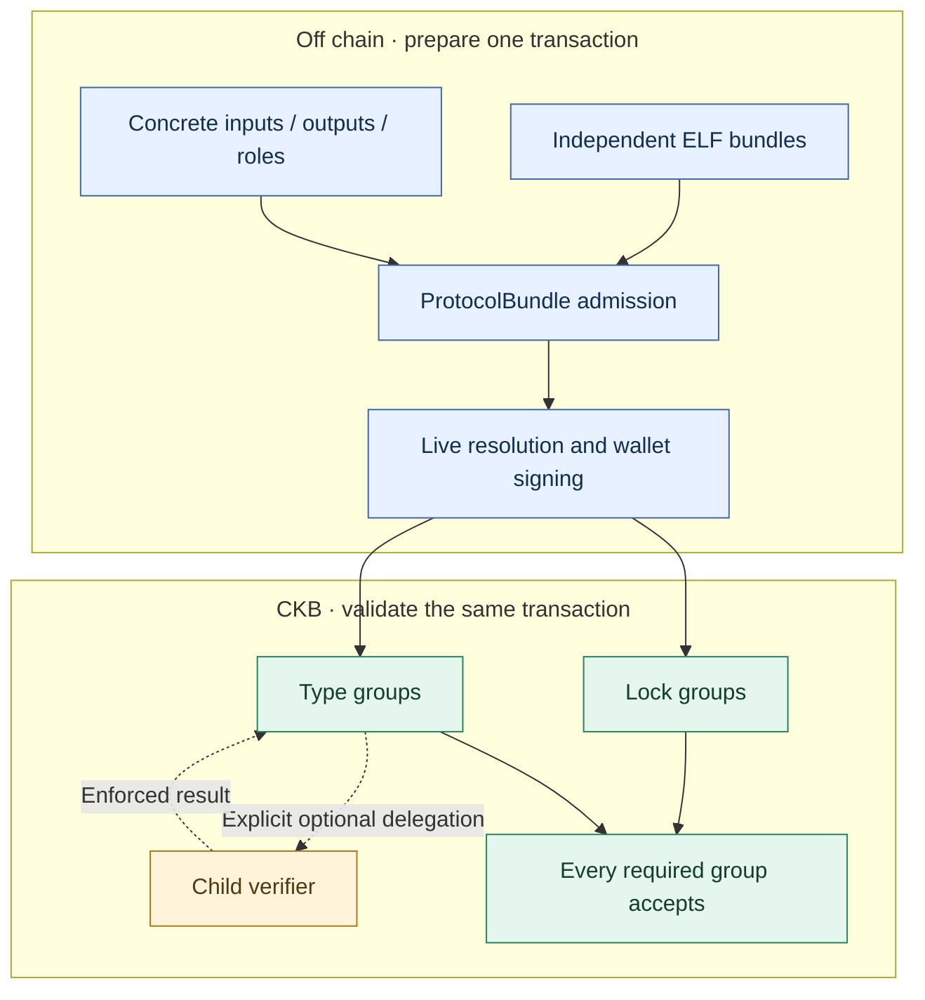
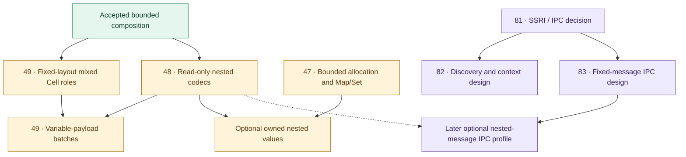

# Tutorial 17: ProtocolBundle End to End

ProtocolBundle v1 composes two or more independently compiled CKB Script
artifacts into one transaction while keeping every Script's artifact identity,
transaction claims, and evidence separate. Sections 1–7 explain the existing
closed-role flow from checked ELF files through an externally signed, bounded
confirmation receipt. Sections 8–11 cover the accepted bounded profiles on the
**0.32 development branch**, their executable examples, and unfinished work.
The published 0.31 tool/browser bundle must not be assumed to implement those
new profiles. Use a matching native compiler and checker.

For a Chinese narrative with a raw Rust comparison, read
[Organizing multiple CKB contracts](../tutorials/CELLSCRIPT_CROSS_CONTRACT_NERVOS_TALK.md).
The SSRI/IPC selection discussion is [#81](https://github.com/CellScript-Labs/CellScript/issues/81);
its proposals are separate from the capabilities demonstrated here.

The current endpoint records a canonical-chain inclusion and caller-selected
depth without claiming absolute finality. Automatic builder-selected live Cells
and independently measured per-Script-Group cycles remain open.

## Before starting: three different operations

- **Compose a transaction:** several independent Lock/Type groups validate the
  same inputs and outputs. ProtocolBundle organizes artifacts and claims.
- **Select a participant:** authenticate its implementation, interface, concrete
  Script and role. A compatible interface alone grants no authority.
- **Run a child program:** explicitly spawn a verifier and enforce its result.
  The child inherits the consumer context; it is not the selected peer's group.

Reading another group's Cell does not run that group. Including code as a
CellDep does not make it execute. Each required group still needs actual
transaction validation, and a child needs its own enforced execution path.



## 1. Know the three identities

ProtocolBundle uses three versioned schemas for different jobs:

| Identity | Meaning |
|---|---|
| `cellscript-protocol-bundle-input-v1` | Local authoring document with evidence file paths |
| `cellscript-protocol-bundle-v1` | Canonical resolved bundle covered by `bundle_hash` |
| `cellscript-protocol-bundle-report-v1` | Offline result containing the resolved bundle, conflicts, and evidence template |

Generated TypeScript builders use
`cellscript-protocol-bundle-artifact-binding-v1` to bind one generated package
to its exact metadata, ELF, interface, builder manifest, selected entry, Script
role, and deployment. Closed cross-Script roles use
`cellscript-protocol-closed-role-v1`.
Successful admission also returns
`cellscript-exact-script-handle-receipt-v3` plus the fixed-width
`cellscript-exact-script-handle-value-v1` representation. The receipt explains
which checked entry/interface/artifact/deployment the value identifies; the
value itself grants no lifecycle or authorization capability.

The bundle hash is the CKB Blake2b-256 digest of the domain string, a zero byte,
and canonical JSON for the resolved bundle. Local file paths do not enter that
hash. Artifact hashes, deployment identities, selected entries, physical
indexes, and transaction arrays do.

## 2. Prepare every artifact independently

For every Lock Script, Type Script, or bounded spawned verifier, retain:

- the RISC-V ELF;
- compile metadata;
- the lowering record;
- the source map;
- the exact deployment Script and code CellDep; and
- for an action entry, the generated action-builder manifest.

Build action artifacts and their TypeScript package with the normal public
commands:

```bash
cellc build . --target riscv64-elf --target-profile ckb --entry-action transfer
cellc gen-builder . --target typescript --output target/cellscript-builder/typescript --target-profile ckb --json
```

Repeat that process in each independently built package. A bundle does not link
the ELFs or erase package boundaries. Its first job is to prove exactly which
artifacts and deployments the proposed transaction uses.

If an artifact came from the Registry, inspect its accepted `verified_build`
evidence. The following triple means the Registry artifact verifier found a
complete CellScript CKB ELF sidecar set and passed it through the standalone
checker:

```json
{
  "protocol_bundle_schema": "cellscript-protocol-bundle-v1",
  "protocol_bundle_artifact_binding_schema": "cellscript-protocol-bundle-artifact-binding-v1",
  "protocol_bundle_runtime_adapter": "cellscript-ckb-adapter"
}
```

The triple is discovery evidence. The local bundle checker still re-admits the
exact ELF and sidecars. Generic hash-bound executables and source-only snapshots
do not receive it.

## 3. Describe one shared transaction

Create `protocol-bundle.json` beside the evidence files. Its top-level shape is:

```json
{
  "schema": "cellscript-protocol-bundle-input-v1",
  "network": {
    "chain_id": "ckb_testnet",
    "genesis_hash": "0x...64 lowercase hex digits..."
  },
  "artifacts": [],
  "transaction": {
    "version": 0,
    "inputs": [],
    "outputs": [],
    "witnesses": [],
    "cell_deps": [],
    "header_deps": [],
    "fee_policy_hash": "0x...64 lowercase hex digits...",
    "change_policy_hash": "0x...64 lowercase hex digits...",
    "builder_assumption_evidence": {}
  },
  "roles": [],
  "closed_roles": [],
  "witnesses": [],
  "cell_deps": [],
  "header_deps": [],
  "policies": []
}
```

Each artifact entry names its package coordinate, exact `Cell.lock` node,
selected action/lock/function, Script role, deployment, and evidence files.
Transaction arrays preserve CKB order. Role and witness claims then explain
which artifact owns or reads each physical slot.

Use `exclusive` for the artifact that owns a Cell role and `shared-read` for
another Script that only observes the same Cell. Witness fields use
`exclusive-write` and `shared-read`. The checker rejects multiple owners,
multiple writers, incompatible ABIs, different signing domains, conflicting
Script identities, and claims for indexes outside the skeleton. It reports
stable `PB200` through `PB213` codes and never chooses a winner.

A `closed_roles` entry turns compatible physical claims into a typed
cross-Script relation. It names one provider claim, one or more consumer
claims, and an exact Molecule type name/hash. Every participant must expose
that schema in checked metadata. The resolver copies each participant's
interface hash, ELF hash, selected entry, and deployment Script identity into
the canonical bundle. Providers use `exclusive` or `exclusive-write`;
consumers use `shared-read`; all references must resolve to the identical Cell
slot or witness field. Open/runtime-selected participants use the separate
admission path in section 8; do not put them into this closed-role schema.

## 4. Run the offline composition check

```bash
cellc protocol bundle check protocol-bundle.json --json
cellc protocol bundle check protocol-bundle.json --output build/protocol-bundle.report.json
```

A successful report has `status: "ok"`, no conflicts, verified structural
admission for every artifact, and one successful metadata transaction-validation
record per artifact. The command does not use RPC, sign, or execute CKB-VM.

When the check fails, inspect each conflict's `code`, `key`, and `artifacts`.
Change the transaction or its explicit ownership claims and run the same check
again. Do not resolve a conflict by removing the metadata or builder evidence
that exposed it.

## 5. Advance the exact transaction through the Rust adapter

Pass the report bytes to
`cellscript_ckb_adapter::materialize_protocol_bundle_report`. Concrete input
OutPoints, output data, and witness field bytes must already be hash-bound in
the successful report. The adapter emits one packed CKB transaction and records
its raw hash, complete serialized hash, byte size, capacities, candidate fee,
and every direct Script Group's global and group-relative indexes.

The node-backed states are ordered:

| State | New evidence |
|---|---|
| `MaterializedProtocolBundleTx` | Exact Molecule transaction bytes and hashes |
| `LiveResolvedProtocolBundleTx` | Every input is live and its output/data/capacity still matches |
| `LiveDependenciesResolvedProtocolBundleTx` | Code Cells and complete dep groups match admitted ELF and Script identity |
| `ReadyToSignProtocolBundleTx` | Both live receipts bind the same transaction and network |
| `SignedProtocolBundleTx` | Caller-owned unlockers filled Lock witness fields without changing the raw transaction |
| `SignedDryRunProtocolBundleTx` | The node executed the signed bytes successfully |
| `TxPoolAcceptedProtocolBundleTx` | Tx-pool acceptance binds node cycles and computed fee |
| `SubmittedProtocolBundleTx` | The node returned the expected transaction hash |
| `ConfirmedProtocolBundleTx` | Canonical inclusion survived the requested bounded confirmation depth |

`CkbSdkAcceptance` checks the connected chain ID and genesis hash before live
resolution. Direct code deps must contain bytes with the admitted ELF data hash.
A `dep_group` is decoded as a canonical Molecule `OutPointVec`; every member
must be live and a matching code Cell must be present.

The signed path runs caller-supplied CKB SDK `ScriptUnlocker` implementations.
It permits Lock witness changes while preserving the raw transaction and
compiler-owned input/output-type witness fields. Private keys never become
fields in a ProtocolBundle or evidence record.

## 6. Use the generated TypeScript state machine

Every generated TypeScript action-builder package exports:

- `bindProtocolBundleArtifact`;
- `bindCheckedExactScriptHandle` and
  `exactScriptHandleFromCheckedBundle`;
- `deploymentLineHandleFromCheckedBundle` and
  `deploymentLineHandleEvidence` for checked Type-hash lines;
- `bindClosedProtocolRole`;
- `createProtocolBundleClient`;
- the same nine state names;
- `ProtocolBundleSigningRequest`; and
- the bundle, report, and artifact-binding schema constants.

The generated client accepts an application runtime that calls the Rust adapter
or an equivalent service boundary. Its flow is resumable around an external
wallet:

```typescript
const artifact = builder.bindProtocolBundleArtifact({
  id: "token-type",
  packageCoordinate: "example/token@1.0.0",
  lockNodeId: "token@1.0.0|registry:example/token@1.0.0|env=ckb-testnet",
  entry: { kind: "action", name: "transfer" },
  scriptRole: "type",
  deployment,
});

const sharedSchema = artifact.schemaContracts.find(
  (schema) => schema.type_name === "SettlementRecord",
);
if (!sharedSchema) throw new Error("SettlementRecord schema is not exported");

bundleInput.closed_roles = [builder.bindClosedProtocolRole({
  roleId: "settlement-record",
  kind: "cell",
  schemaIdentity: sharedSchema,
  provider: { artifact, claim: "settlement-output" },
  consumers: [{ artifact: authArtifact, claim: "settlement-output" }],
})];

const client = builder.createProtocolBundleClient(runtime);
const flow = await client.prepare(bundleInput, [artifact, authArtifact]);
const exactHandle = builder.exactScriptHandleFromCheckedBundle(
  flow.checked,
  artifact,
);
const request = client.signingRequest(flow.prepared);

// Send request.unsignedTransaction to a wallet or hardware signer.
const signed = await client.resumeSigned(flow.prepared, signedTransaction);
const accepted = await client.acceptSigned(signed);
const submitted = await client.submit(signed, accepted.accepted);
const confirmed = await client.confirm(submitted, {
  requiredConfirmations: 6,
  maxAttempts: 120,
  pollingIntervalMs: 5000,
});
```

`request.privateKeysIncluded` is always `false`. The client rejects duplicate
artifact IDs, unknown stage names, a failed offline report, and changes to the
bundle or raw-transaction identity between stages. The application owns wallet
interaction and the concrete transport to `cellscript-ckb-adapter`.

## 7. Read the evidence literally

An aggregate `estimate_cycles` success can mark direct groups as accepted under
the same transaction bytes, but that RPC does not attribute cycles to individual
groups. Per-group cycle fields therefore remain empty. Spawned verifiers remain
unobserved unless separate evidence proves execution.

`SubmittedProtocolBundleTx` proves that the node accepted a submission request
and returned the expected transaction hash. It remains explicitly uncommitted.
The confirmation poll uses `get_transaction`'s canonical committed location and
`get_tip_header` to derive depth. If an observed inclusion disappears or moves,
it increments `reorgs_observed` and restarts the count. Before returning it reads
the location again. `ConfirmedProtocolBundleTx` records that bounded snapshot,
including the inclusion block/index and observed tip, while its
`finality_claim` remains `bounded-observation-not-absolute-finality`.

For the complete field and conflict contract, read
[CellScript ProtocolBundle v1](../CELLSCRIPT_PROTOCOL_BUNDLE.md). For deployment
and node adapter details, read the
[CKB adapter contract](../CELLSCRIPT_CKB_ADAPTER.md).

## 8. Select an open participant on the 0.32 development branch

Use `cellc protocol bundle check bundle.json --open-admission open.json --output report.json --json`
to reconstruct private source receipts and bind a selected participant before
materialization. Generated builders for actions and Locks expose
`openHandleWitnessFromCheckedBundle(report, consumer, parameter)`; its 664-byte
payload contains the exact 656-byte selection under the committed args root.
The native checker, CLI, generated helper and SDK must agree on the complete
transaction bytes. Changing the final witness requires fresh admission and signing.

Both Lock and Type consumers may select checked Type-policy, single Type/Lock
participants or parameterless spawned verifiers. The latter require an explicit
unconditional `ckb::spawn_wait_cell_dep_hex4` of the selected dependency after
`ckb::require_cell_dep_open_verifier_handle_from_args`. The checker verifies
dependency and child-exit binding; only execution establishes that the child
succeeded. The child has the consumer's transaction/Script context, not a peer
Script group. An observed foreign Cell never grants local lifecycle authority.

The complete input schema, admitted codecs, fail-closed limits and tests are in
the [open-handle design](../CELLSCRIPT_OPEN_HANDLE_DESIGN.md).

### Choose implementation policy and instance policy separately

A complete Script includes `code_hash`, `hash_type`, and `args`. Reusing one
ELF does not make two differently configured Scripts the same instance.

| Implementation selection | Instance selection | Meaning |
|---|---|---|
| Exact | Exact | One implementation and one concrete configuration |
| Compatible, authorized set | Exact | An admitted implementation with a fixed instance |
| Exact | Constrained | One implementation, configurations satisfying a bounded policy |
| Compatible, authorized set | Constrained | Both checks apply independently |

The constrained combinations are the accepted bounded #80 profile, documented
in [Constrained Script instances](../CELLSCRIPT_INSTANCE_POLICY.md). Its
`InstanceScriptHandle<I>` does not replace the older exact/open encodings.
The selected concrete Script remains bound even when several instances satisfy
policy: accepting A does not authorize substituting policy-valid B.

For this profile, the `--open-admission` file uses
`cellscript-protocol-instance-admission-input-v2`; each instance binding includes
its canonical `instance_policy`. The selection is 1768 bytes, with a 1776-byte
CSARG payload. Generated builders expose `encodeInstanceHandleWitness` and
`instanceHandleWitnessFromCheckedBundle`. Do not feed these bytes to the old
656-byte open-handle decoder or manually concatenate witness fields.

A practical preparation sequence is:

1. Freeze the consumer package sources, candidate implementations and checked
   interfaces; resolve their code/deployment evidence.
2. Select exact or compatible implementation admission. Then define the instance
   args layout and allowed predicates, together with authenticated consumer
   configuration. Obtain bounds/encodings from the profile, not guessed offsets.
3. Select actual transaction Cells and the concrete participant Script. Bind
   global/group-relative indexes, input snapshots, dependency bytes, required
   groups and complete final transaction bytes.
4. Run the same CLI with the instance admission request. Extract the generated
   witness from the checked report and preserve all compiler-owned fields.
5. Materialize and recheck exact bytes in the adapter; resolve live dependencies
   and inputs, sign, and execute every required group. Changed transaction data
   requires fresh admission and signatures.

There is no automatic discovery or generic service call hidden in this flow.
`SSRI.get_methods` and a future IPC client are separate proposals, not alternative
ways to skip these checks.

## 9. Follow a real example: issuing and retiring documents

The non-financial acceptance fixture uses two independently compiled packages:

- [Document Type](../../tests/fixtures/instance_policy/document.cell.in): the
  permitted issuer Lock is compiled into the implementation; creation checks
  issuer authorization and custody. Retirement rejects successor documents and
  checks the expected complete digest.
- [Observer Lock](../../tests/fixtures/instance_policy/document_observer.cell.in):
  admits one selected document instance and observes its input; it cannot issue
  or consume a foreign resource by itself.

Document args are exactly 32 bytes: a 16-byte namespace, LE64 category, and LE64
serial. Its 64-byte data repeats those args and appends a 32-byte digest. The
observer policy fixes its namespace, admits categories 1–5, and requires a
nonzero serial. Each observer also binds the concrete selected Script hash.
The serial is issuer-assigned, not a globally enforced NFT uniqueness claim.

This is the observer's existing source fragment; the full linked fixture also
contains the module import and the fixed `Document` layout:

```cell
public lock verify(witness handle: InstanceScriptHandle<foreign>) -> bool {
    verification
    ckb::require_instance_script_participant_from_args(
        ckb::cell_dep(0), handle, ckb::input<Document>(1),
    )
    true
}
```

`cell_dep(0)` and transaction input `1` are intentional positions in this
fixture, not automatic code or Cell discovery. A different transaction layout
needs matching declarations and admission. Returning `true` here says that this
Lock's condition passed; the document Type and issuer Lock still have work.

### Reproduce and inspect in order

1. Use a native checkout matching the documented profile. The retained accepted
   runtime snapshot is `f55508b572aa56c9c7298766bda28f089d57fe14`; the final
   acceptance documentation is in `602795b3f8a095860eeb544518778495a7e55976`.
   The fixture creates temporary packages and fills the issuer hash placeholder;
   the `.cell.in` files are not standalone deployment packages.
2. Read [the test driver](../../tests/support/instance_document.rs), especially
   `InstancePolicy` and its `ArgsConstraint` fields. These explicit Rust-side
   preparation APIs explain the constraints hidden behind the compact DSL call.
3. For a focused fresh VM reproduction, use the repository's pinned Rust toolchain:

   ```bash
   cargo test --locked -p cellscript --test frozen_interface instance_document::issued_document_instances_require_real_issuer_custody_and_peer_execution -- --exact --test-threads=1
   ```

4. Follow the test's signed issuance transactions before its retirement cases.
   Only ordinary funding Cells are seeded; the documents are genuinely created
   by transactions accepted by all required groups in the local VM harness.
5. Inspect `target/instance-policy-evidence/document/O0` through `O3`: rendered
   sources, checked artifacts, dependency records, input snapshots and the
   sixteen accepted/rejected signed transaction cases at each optimization level.
6. Compare the positive cases with category 6, wrong custody, changed digest,
   missing peer, and policy-valid B substituted for selected A. Identify **which
   group** rejects each case; an unrelated signature error is not equivalent
   evidence of the intended rule.
7. Consult [the retained acceptance index](../reports/0.32/instance-policy-acceptance/README.md)
   for hashes, full gate provenance and full-backend reproduction prerequisites.
   The focused command above is not a substitute for those gates.

This fixture is local full-group VM execution plus local live-Cell/capacity
bookkeeping. It is not a node submission, mainnet deployment, or independent
human audit. The existing two-pool fixture demonstrates two independently
configured instances, but it does not complete LP lifecycle, canonical pool
discovery, general routing, or generated financial-builder acceptance.

### What would raw Rust look like?

A Rust author can implement exactly the same protocol using `ckb-std` and reuse
helper libraries. The responsibility split, rather than a line-count contest,
is the useful comparison:

| Responsibility | Raw Rust contract / application | CellScript contract / application |
|---|---|---|
| Load actual Script and Cell data | `ckb-std` source/index reads and checked decoding | Typed views plus admitted runtime helpers |
| Authenticate implementation and instance | Application/library verifies exact identities, policy and concrete target | Handle admission and independently checked generated enforcement |
| Define issuer, custody and lifecycle | Explicit application predicates | Explicit application predicates; not inferred from a handle |
| Assemble inputs, outputs and witnesses | SDK plus protocol-specific builder | Generated builders + ProtocolBundle/adapter; fixture setup still explicit |
| Validate complete transaction | Tests execute every necessary group | Same requirement; metadata alone is insufficient |
| Add a new IPC service | Rust service/codec/runtime with its own constraints | Still proposed under #83; no general service syntax claimed |

For a side-by-side responsibility sketch and code, see the
[Chinese community article](../tutorials/CELLSCRIPT_CROSS_CONTRACT_NERVOS_TALK.md#原生-rust-会怎样写).
The Rust sketch is explanatory pseudocode, not a measured replacement for the
accepted fixture; no performance advantage is inferred.

## 10. Remaining foundations and their order

Status checked on 2026-10-18. Closed issues describe their admitted bounded
contracts, not unrestricted composability. #9/#10/#11/#28/#29/#80 are closed;
#50 (constructor typing) and #51 (bounded byte encoding) are also closed.
The three general extensions below remain open, planned for 0.33 without a
completion-date promise:

| Priority / issue | First useful increment | Completion evidence to require |
|---|---|---|
| 1 / [#49](https://github.com/CellScript-Labs/CellScript/issues/49) | Fixed-layout heterogeneous Cell roles, complete selection and predecessor/successor pairing; then variable payloads | Missing/extra/duplicate/mispaired Cell rejection, authority preservation, all-group transactions and resource limits |
| 2 / [#48](https://github.com/CellScript-Labs/CellScript/issues/48) | Bounded lists of byte strings and records with variable payloads, using canonical codecs | Independent codec vectors, malformed offset/length rejection, actual witness/Cell successor checks |
| 3 / [#47](https://github.com/CellScript-Labs/CellScript/issues/47) | Invocation-local allocation-backed values, followed by deterministic Map/Set | Ownership/allocation failure tests, stable iteration, maximum resource measurements |



Arrows show semantic dependencies, not GitHub-enforced blocking relationships.
#49 fixed layouts and #48 read-only decoding can proceed without #47. An IPC
experiment using fixed messages also need not wait for all three. Optional owned
nested values need an explicitly supported combination of #47 and #48.

A practical implementation schedule is: freeze each shape and its ownership
rules; build one small non-financial example; implement the runtime and checker
boundary; add hostile complete transactions and independent vectors; measure
maximum successful/late-rejecting cases; update affected editor/builders/docs;
run the applicable gates and record review disposition. New syntax or a happy
path alone does not close an issue.

## 11. Where SSRI and IPC fit next

[SSRI](https://talk.nervos.org/t/en-cn-script-sourced-rich-information-script/8256)
can make Script-sourced information and construction logic available to tools.
[`ckb-script-ipc`](https://github.com/XuJiandong/ckb-script-ipc)
provides generated request/response services over process communication and
also supports native host execution. Their responsibilities overlap, but they
are not drop-in substitutes for each other or for participant authorization.

- [#81](https://github.com/CellScript-Labs/CellScript/issues/81): compare current
  paths, SSRI adaptation, IPC services, and a layered combination using the same
  examples and explicit maintenance/interoperability costs.
- [#82](https://github.com/CellScript-Labs/CellScript/issues/82): discovery,
  context identity, cache invalidation and candidate-transaction boundaries.
- [#83](https://github.com/CellScript-Labs/CellScript/issues/83): typed bounded
  messages, child lifetime, failure propagation, resource limits and upstream
  compatibility.

These are design reviews. No selection has been finalized, no new service API
is admitted, and no measurements comparing those candidates are claimed here.
